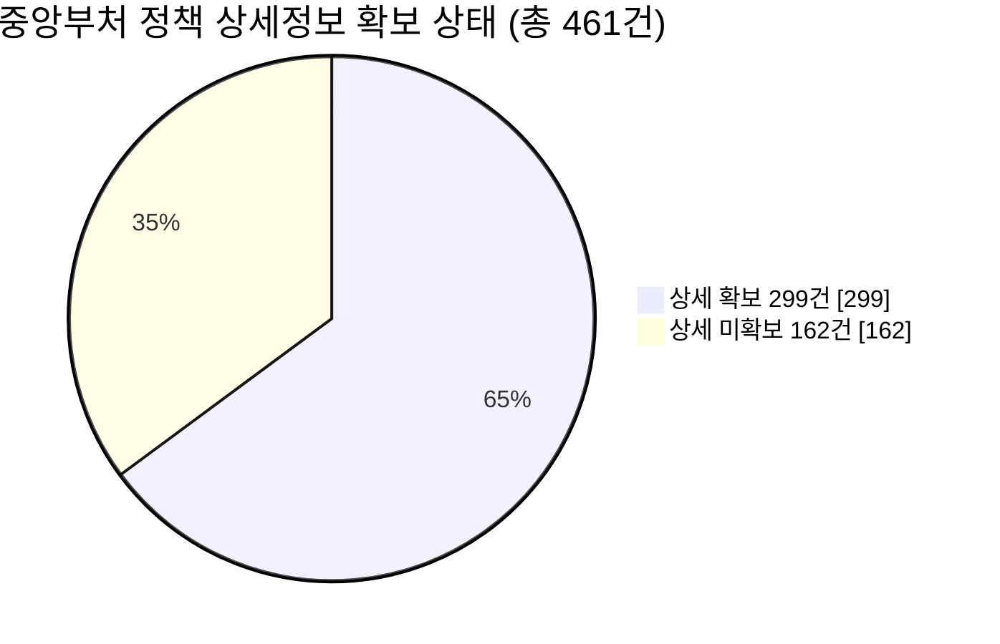
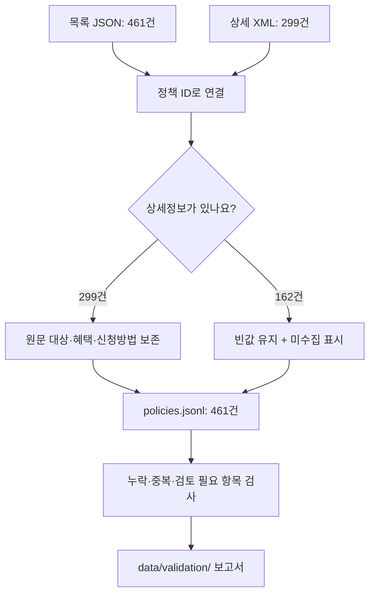
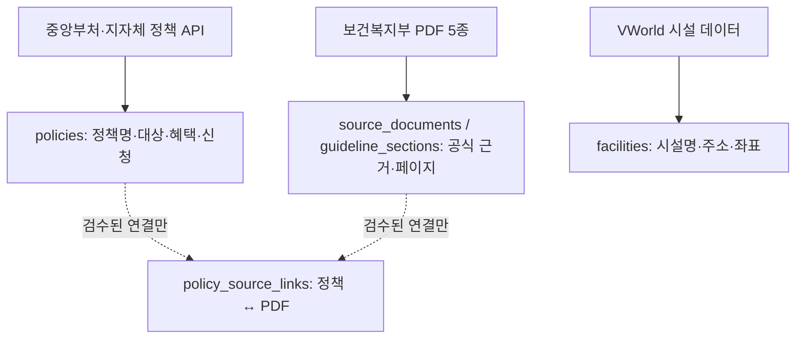
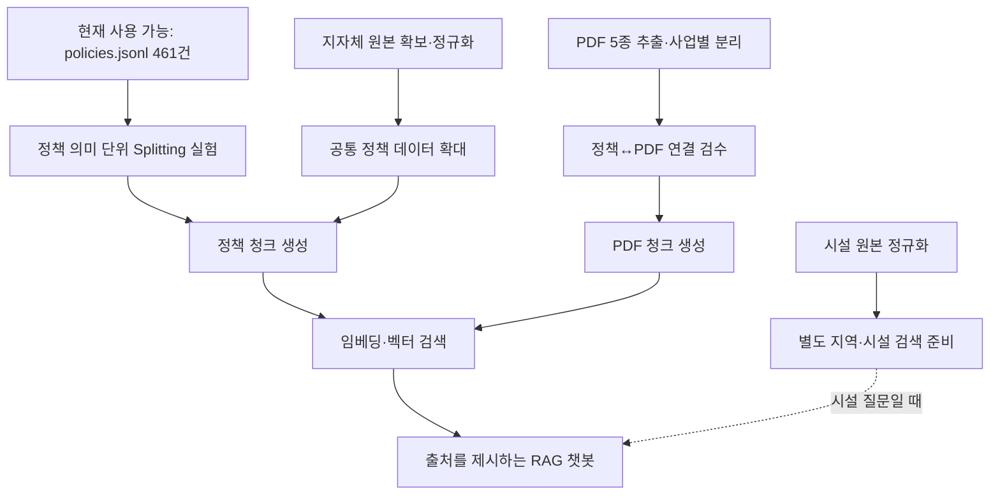

# 노인 복지 RAG — 데이터 전처리 현황

> **브랜치:** `feature/pre-splitting-ready` · **기준:** 2026-11-07 · 커밋 `270ccbd`
> **참고:** 팀 문서 `RAG_데이터_통합_및_문서구조_설계(2).md`, [`docs/PRE_SPLITTING_REPORT.md`](docs/PRE_SPLITTING_REPORT.md)

이 브랜치는 **복지정책 데이터를 AI 검색에 사용하기 좋은 형태로 정리한 작업**을 공유합니다. 현재는 **중앙부처 정책 461건의 정규화와 기본 자동 검증까지 완료**했습니다. **지자체·시설·PDF 통합과 RAG Splitting은 아직 완료하지 않았습니다.**

처음 보는 팀원이라면 **① 아래 체크리스트 → ② 작업 흐름 → ③ 파일 설명 → ④ 다음 작업** 순서로 보면 됩니다.

---

## 1. 팀 통합 가이드 전체 체크리스트

**표 읽는 법:** `완료`는 이 브랜치에서 확인한 작업, `부분`은 일부만 처리했거나 검토가 남은 작업, `미진행`은 아직 처리하지 않은 작업입니다. **빈 결과 파일이 있다고 완료로 표시하지 않았습니다.**

| 구분 | 해야 할 일 | 상태 | 이번 브랜치 기준 확인 내용 |
|---|---|---|---|
| 원본 수집 | 중앙부처 정책 목록 확보 | ✅ 완료 | 목록 461건, ID 461개 |
| 원본 수집 | 중앙부처 정책 상세정보 확보 | ◐ 부분 | XML 299건 확보, **162건 미확보** |
| 원본 수집 | 서울·경기·전북 지자체 API 원본 확보 | — 미진행 | 가이드에 1,485건 기재, **이번 브랜치에는 미통합** |
| 원본 수집 | 경기 상세정보 미수집 485건 보완 | — 미진행 | 지자체 원본 반입 후 처리 필요 |
| 원본 수집 | 전남 지자체 정책 수집 여부·제공 범위 결정 | — 미진행 | 가이드의 지역 범위 보완 사항 |
| 원본 수집 | VWorld 노인복지시설 원본 확보 | — 미진행 | 실제 시설 입력 없음 |
| 원본 수집 | 보건복지부 PDF 5종 확보 | — 미진행 | 실제 PDF 입력 없음 |
| 데이터 구조화 | 중앙부처 목록·상세를 공통 정책 형식으로 통합 | ✅ 완료 | `policies.jsonl` 461행 |
| 데이터 구조화 | 지자체 정책을 같은 형식으로 정규화 | — 미진행 | CSV/캐시 원본 필요 |
| 데이터 구조화 | 시설을 정책과 분리해 정규화 | — 미진행 | `facilities.jsonl`은 0바이트 |
| 데이터 구조화 | PDF 본문·표·페이지를 추출하고 문서 정보 저장 | — 미진행 | `source_documents.jsonl`은 0바이트 |
| 데이터 구조화 | PDF를 사업·장·절 단위로 의미 구조화 | — 미진행 | `guideline_sections.jsonl`은 0바이트 |
| 데이터 품질 | 중앙부처 JSON·ID 중복·필드 누락 자동 검사 | ✅ 완료 | JSONL 461행 파싱, ID 중복 0건, 누락 목록 생성 |
| 데이터 품질 | 고령층 관련 정책 후보 추려 검수 목록 작성 | ◐ 부분 | 후보 142건, 나머지 319건 검토 필요 |
| 데이터 품질 | 지역명·지역코드·정책 적용 범위 확정 | — 미진행 | 중앙부처 **461건 모두 지역 범위 검토 대기** |
| 데이터 품질 | 시행기간·수정일·자격·금액을 공식 원문과 대조 | — 미진행 | 자동 파싱과 실제 정책 내용 검증은 별개 |
| 데이터 품질 | PDF 표·기준수치·예외 조항 검수 | — 미진행 | PDF 원본 필요 |
| 데이터 품질 | 종합 PDF·노령층 분권 중복 확인 | — 미진행 | PDF 원본 필요 |
| 출처 연결 | 정책명 별칭 및 정책↔PDF 연결 후보 만들기 | ◐ 부분 | 별칭·연결용 **초기 파일만** 생성, 실제 후보 없음 |
| 출처 연결 | 정책↔PDF 연결을 사람이 확인·승인 | — 미진행 | 승인된 연결 0건 |
| 중복·충돌 | 출처 간 중복·자격·연도 충돌 점검 | — 미진행 | `conflicts.jsonl`은 0바이트, 교차검증 미수행 |
| RAG 준비 | 정책을 의미 단위로 Splitting | — 미진행 | `policy_chunks.jsonl` 미생성 |
| RAG 준비 | PDF를 의미 단위로 Splitting | — 미진행 | `guideline_chunks.jsonl` 미생성 |
| 저장·검색 | PostgreSQL 테이블 구축·데이터 적재 | — 미진행 | DB 적재 미수행 |
| 저장·검색 | 임베딩 및 Qdrant 색인 구축 | — 미진행 | 벡터 DB 미구축 |
| 서비스·평가 | 지역 필터·정책/PDF 근거 검색 구현 | — 미진행 | 검색 파이프라인 미구현 |
| 서비스·평가 | 지역 오추천·자격 오류·출처·정보 부족 응답 테스트 | — 미진행 | RAG 평가 미수행 |

**현재 위치를 한 문장으로:** **중앙부처 데이터의 `원본 읽기 → 공통 형태로 변환 → 기본 자동 검사` 단계까지 완료**했고, 팀 가이드에 있는 **전체 데이터 통합·수동 검수·Splitting 이후 단계는 남아 있습니다.**


*왼쪽 네 단계는 **중앙부처 데이터 기준으로 수행**, 오른쪽 세 단계는 **후속 작업**입니다. 중앙부처 상세 162건 보완과 지역 검수는 여전히 남아 있습니다.*

---

## 2. 이번에 실제로 만든 결과

**핵심 숫자 네 개만 기억하면 됩니다.**

- **461건:** 중앙부처 정책 목록 전체 → [`policies.jsonl`](data/processed/policies.jsonl)에 정리
- **299건:** 상세 XML을 정상적으로 읽고 목록과 연결한 정책
- **162건:** 목록은 있지만 상세 설명이 없어 **추가 수집이 필요한 정책**
- **0건:** 현재 확인된 정책 ID 중복



상세정보 확보율은 **약 64.9%**입니다. 461건 모두 JSON 문법 검사를 통과했지만, **461건 모두의 신청 자격이나 지역 조건이 검증됐다는 뜻은 아닙니다.**

또한 자동 규칙으로 **노인 관련 정책 후보 142건**을 추렸습니다. 이는 **사람이 검토할 우선 후보**이지, 나머지 정책이 노인에게 해당하지 않는다는 확정 결과가 아닙니다.

### 왜 이런 정리가 필요한가요?

API 원본의 각 항목은 정책 정보를 담고 있지만, 목록에는 제목만 있고 상세 파일에는 신청 대상·혜택·절차가 따로 들어 있을 수 있습니다. 이를 **정책 ID 기준으로 결합**해야 팀원이 나중에 동일한 구조로 검색·청킹 작업을 진행할 수 있습니다.



**쉽게 말하면**, 서로 다른 양식의 복지정책 서류를 **같은 양식의 카드 461장으로 옮겨 적고**, 정보가 빠진 카드에 **'확인 필요' 표시**를 한 작업입니다. 빠진 자격 조건을 AI가 임의로 채우도록 만들지 않았습니다.

---

## 3. 팀 통합 가이드는 무엇을 최종적으로 만들려고 하나요?

가이드의 가장 중요한 규칙은 **정책·PDF·시설 데이터를 하나의 긴 문서로 합치지 않는 것**입니다. 자료마다 역할이 다르므로 **서로 다른 곳에 정리한 다음, 필요할 때 연결**합니다.



현재 이 브랜치에는 **`policies`의 중앙부처 부분만 실제 데이터가 있습니다.** PDF·시설 데이터 파일은 만들어져 있더라도 **내용이 비어 있습니다.**

가이드에 적힌 **서울 397건 + 경기 692건 + 전북 396건 = 지자체 1,485건**은 **가이드에서 확인한 별도 입력 자료의 숫자**입니다. 이 브랜치의 461건에 이미 합쳐졌다는 뜻이 아닙니다. 마찬가지로 가이드에서 확인한 VWorld 시설 수치와 PDF 5종도 **이번 커밋의 처리 완료 수치가 아닙니다.**

**예시:** 사용자가 '기초연금 신청 방법'을 물으면, 나중에는 API 정책에서 신청 안내를 찾고, 연결이 승인된 공식 PDF 절에서 예외·기준금액을 확인해 **각각의 출처를 함께 제시**하는 것이 목표입니다. **현재 이 기능이 구현되어 있다는 뜻은 아닙니다.**

---

## 4. 브랜치에서 무엇을 보면 되나요?

이번 Commit(`270ccbd`)에서 변경된 파일은 **총 26개**입니다. 팀원이 처음 살펴볼 파일은 다음 세 가지입니다.

1. **[`data/processed/policies.jsonl`](data/processed/policies.jsonl)** — 실제로 정리된 정책 461건. **다음 Splitting 개발의 출발점**
2. **[`data/validation/quality_report.json`](data/validation/quality_report.json)** — 수집·누락·검증 현황을 숫자로 확인하는 보고서
3. **[`docs/PRE_SPLITTING_REPORT.md`](docs/PRE_SPLITTING_REPORT.md)** — 이번 처리 원칙과 남은 검수 내용을 설명하는 기술 보고서

### 폴더 구조

```text
SKN36-Data-Extraction/
├── data/
│   ├── raw/                       원본 입력 (기존 데이터)
│   ├── processed/                 AI 검색에 사용할 공통 형식
│   │   ├── policies.jsonl         실제 데이터: 중앙부처 정책 461건
│   │   ├── facilities.jsonl       빈 파일: 시설 미통합
│   │   ├── source_documents.jsonl 빈 파일: PDF 미통합
│   │   ├── guideline_sections.jsonl 빈 파일: PDF 미통합
│   │   └── policy_source_links.csv 정책↔PDF 연결용 초기 CSV
│   └── validation/                검증 결과·추가 검토 목록
│       ├── quality_report.json
│       ├── missing_detail_policies.csv
│       ├── missing_fields.csv
│       ├── elderly_relevance_review.csv
│       └── region_review_queue.csv
├── scripts/
│   ├── prepare_pre_splitting.py    공통 데이터 생성 스크립트
│   ├── inspect_pre_splitting.py    결과 점검 스크립트
│   ├── _welfare_api.py             API 수집 공통 기능
│   └── collect_welfare*.py         목록·상세 수집 스크립트
└── docs/
    └── PRE_SPLITTING_REPORT.md    전처리 기술 보고서
```

*이 구조는 팀원이 알아야 할 **주요 파일만** 보여줍니다. 모든 파일을 나열한 것은 아닙니다.*

### `policies.jsonl`은 무엇인가요?

**JSONL**은 **한 줄에 정책 하나씩 기록하는 파일**입니다. 예를 들어 461줄이면 정책 461건입니다. 각 정책에는 제목, 대상, 혜택, 신청 방법, 출처, 정보 누락 여부 등을 공통된 규칙으로 정리합니다.

- **상세정보가 있는 정책:** 확보한 원문 정보를 사용합니다.
- **상세정보가 없는 정책:** 빠진 내용은 `null` 등으로 남기고 검토 대상으로 분류합니다.
- **지역 적용 범위를 모르는 정책:** 시도나 전국 정책이라고 추정하지 않습니다.

> 위 설명은 데이터 형식을 이해하기 위한 개념입니다. **실제 JSON 필드명·중첩 구조는 `policies.jsonl`을 열어 확인**하세요.

### 검증 파일은 언제 보나요?

- **`missing_detail_policies.csv`** — 상세 XML이 없는 162건을 추가 수집할 때
- **`missing_fields.csv`** — 지원 대상·선정기준·혜택·신청방법 등 누락 칸을 살펴볼 때
- **`elderly_relevance_review.csv`** — 노인 관련 후보 142건을 사람이 검토할 때
- **`region_review_queue.csv`** — 461건의 정책 적용 지역을 확인할 때
- **`quality_report.json`** — 전체 현황을 빠르게 확인할 때

**주의:** `facilities.jsonl`, `guideline_sections.jsonl`, `source_documents.jsonl`, `conflicts.jsonl`은 현재 **0바이트**입니다. **파일이 존재한다는 사실만으로 해당 작업이 끝났다고 판단하지 마세요.**

---

## 5. 중요한 작업 원칙 세 가지

**① 정보가 없으면 만들어 넣지 않습니다.** 상세 XML이 없는 162건은 목록 정보를 보존하되, 지원 대상·선정기준·혜택·신청방법을 임의로 생성하지 않습니다.

**② 지역을 추정하지 않습니다.** 중앙부처 API에서 수집했다는 이유만으로 모든 정책을 전국 적용으로 설정하지 않습니다. 지금은 **461건 모두 지역 적용 범위 검토가 필요**합니다.

**③ 정책과 PDF를 자동으로 같은 사업이라고 확정하지 않습니다.** 이름이 비슷하면 나중에 연결 *후보*로 만들고, 담당자가 검수하여 승인한 연결만 답변 근거로 사용합니다.

이 세 가지가 중요한 이유는, 복지 서비스에서 잘못된 자격·지역·금액 안내가 실제 이용자의 잘못된 신청이나 기대를 불러올 수 있기 때문입니다.

---

## 6. 다음 팀원은 어떤 순서로 진행하나요?

우선 **현재 파일로 중앙부처 정책 Splitting을 시험 구현**할 수 있습니다. 이와 동시에 다른 담당자는 지자체·시설·PDF 원본 반입과 검수를 진행하면 됩니다. **전체 데이터가 완벽해질 때까지 모든 개발을 멈출 필요는 없습니다.**



**Splitting이란?** 긴 텍스트를 AI가 검색하기 좋은 **의미 단위**로 나누는 작업입니다.

- **정책:** 먼저 정책 하나를 기본 단위로 보고, 너무 길면 `지원 대상·선정기준 / 혜택 / 신청방법` 등으로 나눕니다.
- **PDF:** 글자 수만 보고 자르기보다 `사업 → 장·절 → 대상·조건·예외` 순서로 나눕니다. 표의 금액과 조건이 분리되지 않도록 주의합니다.
- **반드시 보존할 정보:** 정책 ID, 출처, 지역, 기준연도, PDF 문서·페이지, 원문 텍스트.

이후 가이드의 목표 아키텍처인 **PostgreSQL(정책·지역·연결 정보) + Qdrant(정책·PDF 의미 검색)**를 구축하고, 마지막으로 지역 오추천·자격 오류·출처 누락 등을 테스트합니다. **모두 후속 작업이며 이번 Commit에 포함되지 않았습니다.**

---

## 7. 직접 확인하는 가장 간단한 방법

프로젝트 **최상위 폴더**에서 PowerShell을 실행합니다. 다음 확인 명령어들은 **외부 API를 호출하지 않습니다.**

**정책 건수 확인**

```powershell
(Get-Content data/processed/policies.jsonl -Encoding UTF8 | Measure-Object -Line).Lines
# 기대 결과: 461
```

**461건 전부 정상 JSON인지 확인**

```powershell
$ErrorActionPreference = 'Stop'
$count = 0
Get-Content data/processed/policies.jsonl -Encoding UTF8 | ForEach-Object {
    $null = $_ | ConvertFrom-Json
    $count++
}
Write-Host "JSON 파싱 완료: $count 건"
# 기대 결과: JSON 파싱 완료: 461 건
```

**품질 보고서 확인**

```powershell
Get-Content data/validation/quality_report.json -Raw -Encoding UTF8 |
    ConvertFrom-Json |
    Select-Object policy_count, central_valid_xml, central_missing_xml, data_complete_for_splitting
```

기대값은 각각 **461 / 299 / 162 / False**입니다. 마지막 `False`는 **팀 전체 데이터 통합·검수의 완료 조건을 아직 충족하지 않았다**는 뜻입니다.

Python 스크립트 문법은 `uv run python -m compileall -q scripts`로 점검할 수 있습니다. 단, **문법 검사 통과 ≠ 실제 API 수집 및 전체 재현 성공**입니다.

### 재현 및 Git 사용 시 유의사항

- 이번 커밋은 **정제 데이터·검증 결과·관련 코드 중심의 26개 파일**입니다.
- 새로 수집한 일부 **원본 XML**, `collection_logs/`, `uv.lock`, `.env`는 이 커밋에 포함하지 않았습니다. 따라서 **동일한 원본부터 재처리**하려면 원본 파일 확보·경로 확인이 추가로 필요합니다.
- API 키 등 비밀정보를 Git에 올리지 마세요. `.env`를 제외한 사실만으로 과거 커밋이나 다른 파일의 비밀정보까지 검증된 것은 아닙니다.

---

## 한 줄 인계 요약

**이번 브랜치에서 할 수 있는 일:** 중앙부처 정책 **461건의 정제 JSONL을 열어 구조를 확인하고, Splitting 개발을 시작**할 수 있습니다.

**아직 할 수 없는 일:** 이 데이터만으로 **전 지역의 복지정책을 정확히 추천**하거나, **PDF 근거·주변 시설까지 갖춘 RAG 서비스를 완성했다고 말하는 것**입니다.

더 자세한 규칙과 예외는 [`docs/PRE_SPLITTING_REPORT.md`](docs/PRE_SPLITTING_REPORT.md), 숫자와 누락 내역은 [`data/validation/quality_report.json`](data/validation/quality_report.json)을 참고하세요.
