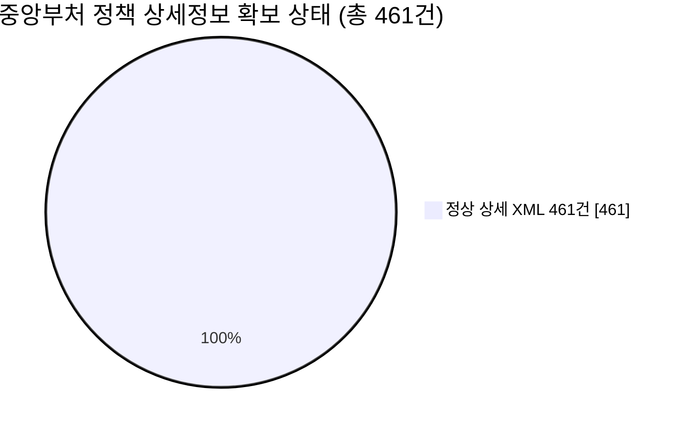
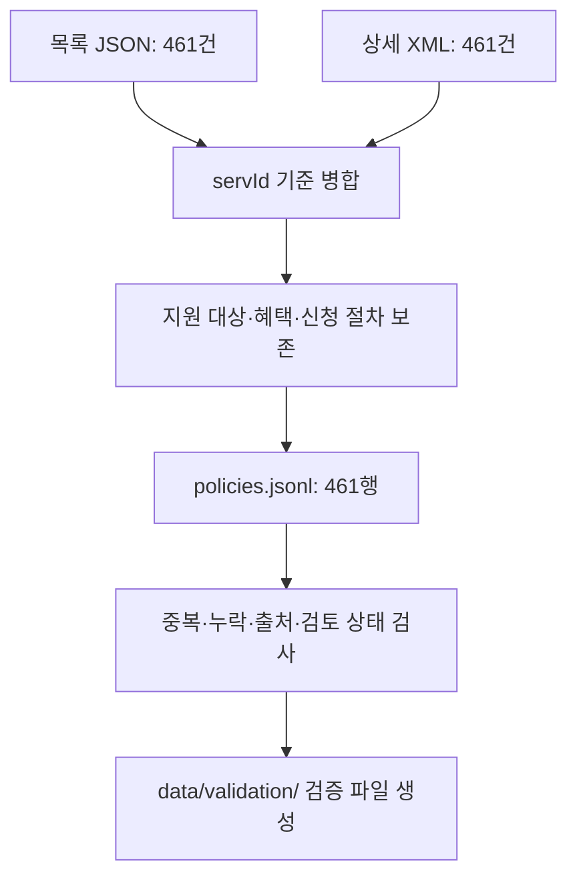
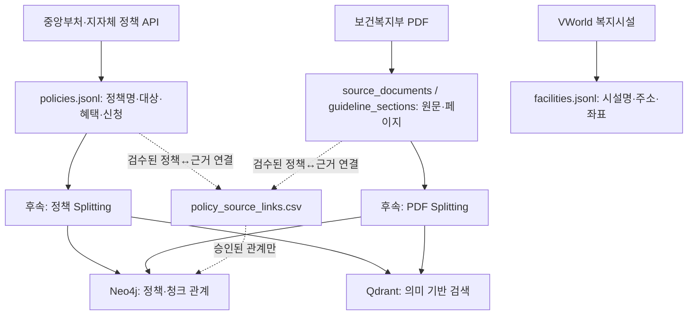
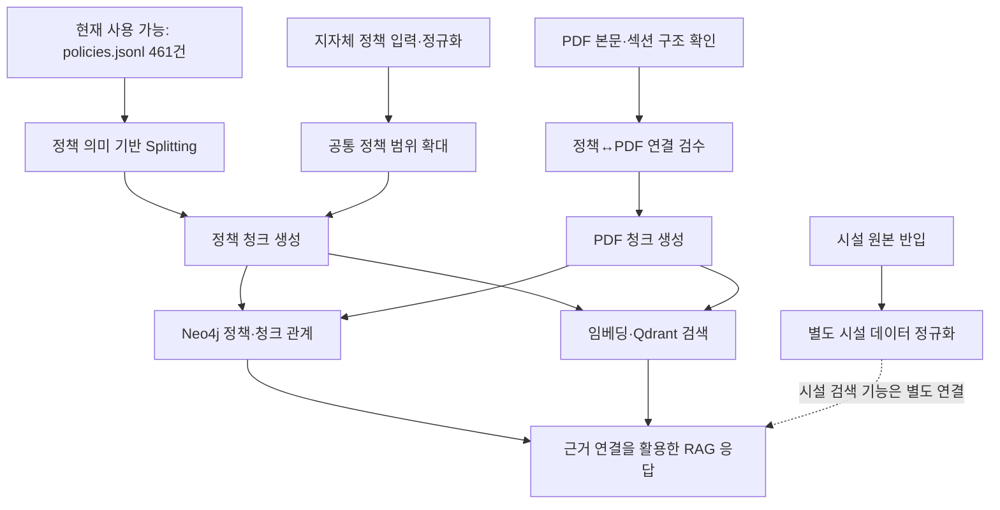

# 노인 복지 RAG — 데이터 전처리 현황

> **작업 브랜치:** `feature/pre-splitting-ready`  
> **최신화 기준:** 2026-11-09 (KST) · 중앙부처 상세 461건 반영 커밋 `f7e3037`  
> **검증 근거:** [`data/validation/quality_report.json`](data/validation/quality_report.json) · [`docs/PRE_SPLITTING_REPORT.md`](docs/PRE_SPLITTING_REPORT.md)

이 브랜치는 **복지정책 데이터를 AI 검색에 사용하기 좋은 공통 형식으로 정리한 작업**을 공유합니다. 현재 **중앙부처 정책 461건의 목록·상세 XML 수집, 공통 JSONL 생성, 기본 자동 검증까지 완료**했습니다.

단, **중앙부처 API 데이터 수집 완료 ≠ 팀 전체 RAG 데이터 준비 완료**입니다. 지자체·복지시설·PDF 자료의 통합, 정책 지역·자격요건 검수, RAG Splitting, 임베딩 및 데이터베이스 적재는 별도의 후속 작업입니다.

처음 보는 팀원이라면 **① 체크리스트 → ② 수집·검증 결과 → ③ 파일 구조 → ④ 다음 작업** 순서로 읽으면 됩니다.

---

## 1. 팀 데이터 통합 가이드 전체 체크리스트

**상태 기준:** `완료`는 이 브랜치에서 실제 파일·검증 결과로 확인된 작업, `부분`은 자동 처리는 했으나 사람의 검토 등이 남은 작업, `미진행`은 이 브랜치에서 결과를 확인할 수 없는 작업입니다. **빈 파일이 존재한다는 이유만으로 완료 처리하지 않습니다.**

| 구분 | 해야 할 일 | 상태 | 이 브랜치 기준 확인 내용 |
|---|---|---|---|
| 원본 수집 | 중앙부처 정책 목록 확보 | ✅ 완료 | 목록 461건, 고유 ID 461개 |
| 원본 수집 | 중앙부처 정책 상세정보 확보 | ✅ 완료 | **정상 상세 XML 461건, 미확보 0건 (100%)** |
| 원본 수집 | 서울·경기·전북 지자체 API 원본 확보 | — 미통합 | 팀 가이드에는 별도 수집 범위가 기재돼 있으나 이 브랜치 입력에는 없음 |
| 원본 수집 | 경기 상세정보 보완 | — 미통합 | 지자체 데이터 수집 담당 작업과 별도 확인 필요 |
| 원본 수집 | 전남 지자체 정책 범위 결정 | — 미진행 | 팀 차원의 대상 지역 확정 필요 |
| 원본 수집 | VWorld 노인복지시설 원본 확보 | — 미통합 | 시설 입력 없음, `facility_count=0` |
| 원본 수집 | 보건복지부 PDF 5종 확보·통합 | — 미통합 | **이 브랜치의 PDF 입력 0건**; 별도 브랜치 작업과 구분 |
| 데이터 구조화 | 중앙부처 목록·상세를 공통 정책 형식으로 통합 | ✅ 완료 | `policies.jsonl` 461행, 상세 연결 461건 |
| 데이터 구조화 | 지자체 정책을 같은 형식으로 정규화 | — 미진행 | 실제 지자체 입력 파일 필요 |
| 데이터 구조화 | 복지시설을 정책과 분리해 정규화 | — 미진행 | `facilities.jsonl`은 빈 결과 파일 |
| 데이터 구조화 | PDF 본문·표·페이지 및 문서 정보 저장 | — 미진행 | `source_documents.jsonl`은 빈 결과 파일 |
| 데이터 구조화 | PDF를 사업·장·절 단위로 의미 구조화 | — 미진행 | `guideline_sections.jsonl`은 빈 결과 파일 |
| 데이터 품질 | 중앙부처 JSON·ID 중복·상세 연결 자동 검사 | ✅ 완료 | 461행, ID 중복 0건, 소스 이슈 0건 |
| 데이터 품질 | 고령층 관련 정책 후보 추려 검수 목록 작성 | ◐ 부분 | **자동 분류 후보 151건, 추가 검토 대상 310건** |
| 데이터 품질 | 정책 적용 지역·지역코드 검수 | — 미진행 | **461건 모두 지역 검토 대기** |
| 데이터 품질 | 시행기간·수정일·자격·금액을 공식 원문과 대조 | — 미진행 | 자동 파싱과 수급 요건의 실질 검증은 다름 |
| 데이터 품질 | PDF의 금액·기준수치·예외 조항 검수 | — 미진행 | PDF 입력 및 원문 페이지 확인 필요 |
| 데이터 품질 | PDF 간 중복 내용 검수 | — 미진행 | PDF 통합 이후 수행 |
| 출처 연결 | 정책명 별칭·정책↔PDF 연결 후보 관리 | ◐ 부분 | 연결용 파일 구조만 마련, 검증된 연결 없음 |
| 출처 연결 | 정책↔PDF 연결 승인 | — 미진행 | PDF 입력·사람의 교차 검수 필요 |
| 중복·충돌 | 출처 간 자격·연도·내용 충돌 검토 | — 미진행 | 다른 데이터 출처 미통합 |
| RAG 준비 | 정책을 의미 단위로 Splitting | — 미진행 | `policy_chunks.jsonl`은 이 스크립트의 산출물 아님 |
| RAG 준비 | PDF를 의미 단위로 Splitting | — 미진행 | `guideline_chunks.jsonl`은 이 스크립트의 산출물 아님 |
| 저장·검색 | Qdrant 벡터 임베딩·색인 구축 | — 미진행 | 임베딩·벡터 DB 적재 미실행 |
| 저장·검색 | Neo4j 노드·관계 구축 및 적재 | — 미진행 | 관계 그래프 생성·DB 적재 미실행 |
| 서비스·평가 | 지역 필터·정책/PDF 근거 검색·RAG 응답 | — 미진행 | 검색 파이프라인·평가 미수행 |

**현재 위치를 한 문장으로:** **중앙부처 정책 461건에 대해 `목록 수집 → 상세 수집 → JSONL 정규화 → 기본 자동 검증`까지 완료**했으며, 다른 출처 통합과 수동 검수·검색 시스템 구현은 아직 남아 있습니다.


*왼쪽 네 단계는 이 브랜치의 중앙부처 데이터 기준으로 완료했습니다. 오른쪽 단계는 전체 시스템 관점의 후속 작업입니다.*

---

## 2. 이번에 실제로 확보한 결과

### 2-1. 핵심 숫자

| 구분 | 최신 결과 | 의미 |
|---|---:|---|
| 중앙부처 정책 목록 | **461건** | 기존 수집 목록의 전체 정책 |
| 정상 상세 XML | **461건** | 정책 ID와 연결되고 기본 XML 검증 통과 |
| 상세 XML 미수집 | **0건** | 현재 목록 기준 미수집 없음 |
| 상세정보 확보율 | **100%** | 461 / 461 |
| 정책 ID 중복 | **0건** | `unique_policy_ids=461` |
| 기본 출처 검증 이슈 | **0건** | `source_issue_count=0` |
| 고령층 관련 자동 분류 후보 | **151건** | 우선 검토할 후보, 확정 대상 아님 |
| 고령층 관련성 추가 검토 | **310건** | 자동 규칙만으로 관련성을 확정하지 않음 |
| 지역 적용 범위 검토 대기 | **461건** | 전국 적용 여부를 임의로 확정하지 않음 |



**상세 XML 확보율 100%**는 *현재 목록 461건에 대응하는 상세 XML이 정상적으로 확보되었다*는 뜻입니다. **461건 전부가 노인 전용 정책이라는 뜻도 아니고, 정책별 지원 자격·혜택 금액·최신 법령·지역 적용 여부까지 전수 검증했다는 뜻도 아닙니다.**

### 2-2. 데이터가 어떻게 만들어졌나요?

중앙부처 복지 API의 **목록 데이터**는 정책명·개요 등 기본 내용을, **상세 XML**은 대상·선정 기준·혜택·신청 절차 등 자세한 내용을 담습니다. 두 자료를 **서비스 ID(`servId`)**로 연결해 정책마다 같은 형식의 데이터를 만듭니다.



**쉽게 말하면**, 양식이 다른 복지정책 서류를 **같은 양식의 정책 카드 461장**으로 옮긴 것입니다. 데이터가 확보되었다고 해서 불분명한 자격 조건이나 지역 범위를 AI가 임의로 채워 넣지는 않습니다.

### 2-3. 기본 검증 범위와 한계

최신 [`quality_report.json`](data/validation/quality_report.json)의 핵심 값은 다음과 같습니다.

```json
{
  "central_list_count": 461,
  "central_valid_xml": 461,
  "central_missing_xml": 0,
  "policy_count": 461,
  "unique_policy_ids": 461,
  "duplicate_policy_id_count": 0,
  "source_issue_count": 0,
  "pending_region_review": 461,
  "facility_count": 0,
  "data_complete_for_splitting": false
}
```

`data_complete_for_splitting=false`는 **전체 소스 통합·검수 완료 조건을 충족하지 않았다는 신호**입니다. 중앙부처 정책만을 이용한 Splitting 시험 개발은 시작할 수 있지만, 팀 전체 데이터셋이 완성되었다고 해석하면 안 됩니다.

---

## 3. 팀 통합 가이드는 무엇을 최종적으로 만들려고 하나요?

가장 중요한 원칙은 **정책·PDF·시설 데이터를 하나의 긴 텍스트로 합치지 않는 것**입니다. 각각 별도의 구조로 관리하되, 실제로 관련이 있다고 검수한 정보만 연결합니다.



- **Qdrant:** 사용자 질문과 의미가 비슷한 정책·문서 청크를 검색하는 역할.
- **Neo4j:** 정책, 공식 문서, 청크 사이의 **검증된 관계**를 관리하는 역할.
- **현재 상태:** 위 데이터베이스·청킹·임베딩은 **설계 방향이지, 이 브랜치에서 구현·적재를 완료한 기능이 아닙니다.**

이 브랜치에서 실제 내용을 가진 공통 데이터는 **중앙부처 정책 `policies.jsonl`**입니다. `facilities.jsonl`, `source_documents.jsonl`, `guideline_sections.jsonl`은 현재 **빈 출력 파일**이며, 타 브랜치에서 수행된 PDF 작업과 혼동하지 마세요.

팀 가이드의 지자체 대상 수치(서울 397건, 경기 692건, 전북 396건, 총 1,485건)는 **이 브랜치의 461건에 포함되지 않습니다.** 타 데이터의 확보 여부와 최신 건수는 해당 담당자의 원본·검증 결과로 별도 확인해야 합니다.

**목표 사용자 시나리오:** 사용자가 “기초연금을 어떻게 신청하나요?”라고 물으면, 정책 API에서 신청 정보를 찾아 설명하고, 검수된 공식 PDF 근거와 함께 출처를 제시합니다. **현재 이 기능이 완성되었다는 뜻은 아닙니다.**

---

## 4. 브랜치에서 어떤 파일을 확인하면 되나요?

가장 먼저 열어 볼 파일은 다음 세 가지입니다.

1. **[`data/processed/policies.jsonl`](data/processed/policies.jsonl)** — 중앙부처 정책 461건. 정책 Splitting의 주요 입력.
2. **[`data/validation/quality_report.json`](data/validation/quality_report.json)** — 상세정보 확보, 데이터 중복, 타 출처의 미통합 현황을 확인하는 최신 보고서.
3. **[`docs/PRE_SPLITTING_REPORT.md`](docs/PRE_SPLITTING_REPORT.md)** — 전처리 규칙 및 구조 설명. **최초 작성 당시의 299건 기준 수치가 남아 있는 과거 보고서이므로 최신 현황은 `quality_report.json`을 우선 확인**하세요.

### 4-1. 주요 폴더 구조

```text
SKN36-3rd-3Team/
├── Pre_splitting_ready_README.md          이 안내 문서 (저장소 최상위)
├── data/
│   ├── raw/welfare/
│   │   ├── welfare_list.json              중앙부처 목록 원본
│   │   └── details/                       개별 상세 XML (로컬 원본 포함)
│   ├── staging/                           파싱 중간 결과
│   ├── processed/
│   │   ├── policies.jsonl                 실제 중앙부처 정책 461건
│   │   ├── facilities.jsonl               이 브랜치에서는 빈 파일
│   │   ├── source_documents.jsonl         이 브랜치에서는 빈 파일
│   │   ├── guideline_sections.jsonl       이 브랜치에서는 빈 파일
│   │   └── policy_source_links.csv        연결 검수용 초기 CSV
│   └── validation/
│       ├── quality_report.json
│       ├── missing_detail_policies.csv    미수집 정책 0건
│       ├── missing_fields.csv             필드 관련 점검 결과
│       ├── elderly_relevance_review.csv   후보 151건 / 추가 검토 310건
│       └── region_review_queue.csv        지역 검수 대기 461건
├── scripts/
│   ├── collect_welfare.py                 목록 수집
│   ├── collect_welfare_details.py         상세 XML 이어받기
│   ├── _welfare_api.py                     API 호출 공통 기능
│   ├── prepare_pre_splitting.py           JSONL·검증 파일 생성
│   └── inspect_pre_splitting.py           처리 결과 확인
└── docs/
    └── PRE_SPLITTING_REPORT.md            최초 전처리 보고서
```

*주요 파일만 보여 준 구조입니다. 데이터 원본의 Git 추적 여부는 파일별로 다를 수 있습니다.*

### 4-2. `policies.jsonl`은 무엇인가요?

**JSONL은 한 줄에 정책 한 건을 저장하는 형식**입니다. 현재 중앙부처 정책 461건을 공통 구조로 기록했습니다.

- **정책 기본정보:** 정책 ID, 이름, 개요, 출처.
- **상세정보:** 지원 대상, 선정 기준, 혜택, 신청 방법 등의 API 원문 필드.
- **검수 상태:** 고령층 관련성, 지역 적용 범위, 누락·품질 상태.
- **원칙:** 원문에서 확인되지 않은 사실을 임의로 만들어 넣지 않음.

실제 속성명은 파일에서 확인해야 하며, **JSONL 정규화와 RAG 청크 생성은 서로 다른 작업**입니다.

### 4-3. 검증 파일별 용도

| 파일 | 확인 목적 | 현재 의미 |
|---|---|---|
| `missing_detail_policies.csv` | 상세 XML 누락 정책 목록 | **미수집 0건** |
| `missing_fields.csv` | 핵심 필드 누락·점검 결과 | 누락 여부와 검증 범위를 구분해서 확인 |
| `elderly_relevance_review.csv` | 고령층 정책 후보 검수 | **151건 후보, 310건 추가 검토** |
| `region_review_queue.csv` | 정책 적용 지역 검수 | **461건 대기** |
| `quality_report.json` | 수집 및 자동 검증 전체 현황 | **최신 현황의 기준 파일** |

**주의:** XML 461건을 확보했더라도 **금액, 실제 수급 자격, 지역 범위, 시행일의 최신성이 전부 확인된 것은 아닙니다.**

---

## 5. 꼭 지켜야 할 데이터 품질 원칙

**① 데이터가 있다고 검증까지 끝난 것은 아닙니다.** 상세 XML 미확보 건수는 **0건**이지만, 원문 필드가 비어 있거나 조건이 복잡할 수 있습니다. 지원 대상·금액·기한을 임의로 보완하지 않습니다.

**② 지역을 추정하지 않습니다.** 중앙부처 API에서 수집했다는 이유로 모든 정책을 전국 적용으로 확정하지 않습니다. 현재 **461건 모두 지역 범위 검토 대기**입니다.

**③ 정책과 PDF의 연결은 사람이 검수합니다.** 문서에 정책명이 나온다는 이유만으로 같은 사업이라고 단정하지 않습니다. 연결 후보를 만든 뒤 적용 대상·기준연도·근거 페이지를 검수합니다.

**④ 고령층 관련성 자동 분류는 최종 판단이 아닙니다.** 151건은 우선 검토 후보일 뿐이고, 나머지 310건도 추가 확인이 필요합니다. **461건 모두가 고령층 전용 정책이라는 뜻이 아닙니다.**

이 원칙은 챗봇이 잘못된 수급 자격·금액·지역 조건을 안내하는 위험을 줄이기 위한 것입니다.

---

## 6. 다음 담당자는 어떤 순서로 진행하나요?

**중앙부처 정책 461건의 Splitting 시험은 시작할 수 있습니다.** 동시에 별도 담당자는 지자체·시설·PDF 소스를 통합하고 고위험 정보(지역·자격·기준금액·기한)를 검수하면 됩니다.



**Splitting이란?** 긴 정책·문서를 AI가 검색하기 쉬운 **의미 단위의 작은 글 묶음(청크)**으로 나누는 작업입니다.

- **정책:** 정책별 ID·제목을 보존하고, 길이가 길면 `지원 대상/선정 기준`, `혜택`, `신청방법` 등 의미별로 분리합니다.
- **PDF:** `문서 → 사업/장/절 → 대상·조건·예외` 구조를 우선 활용하고, 금액·조건이 들어 있는 표의 맥락이 끊기지 않도록 점검합니다.
- **공통 메타데이터:** 정책 ID, 출처, 지역 검수 상태, 기준시점, PDF 문서·페이지 등을 청크에서도 추적 가능하게 유지합니다.
- **Qdrant + Neo4j:** 동일한 정책·청크의 안정적인 식별자를 사용해 의미 검색 결과와 관계 정보를 연결하도록 설계합니다. **현재 DB 적재는 수행되지 않았습니다.**

전체 데이터 통합·검수 완료 후에는 임베딩·검색 품질 평가를 실시하고, 특히 **잘못된 지역 추천, 자격 요건 누락, 출처 없는 답변**을 검증해야 합니다.

---

## 7. 직접 확인하는 방법

프로젝트 **최상위 폴더**에서 PowerShell을 실행합니다. 아래 확인 명령어는 **외부 API를 호출하지 않습니다.**

**① 저장된 상세 XML 및 미수집 건수 확인**

```powershell
uv run python scripts/collect_welfare_details.py --check
# 예상: 목록 461건 / 정상 상세 XML 461건 / 비정상 XML 0건 / 미확보 0건
```

> 이 명령은 **로컬 원본 XML 461개가 해당 경로에 있을 때** 예상대로 출력됩니다. GitHub에 정제 데이터만 내려받은 팀원은 원본 XML을 별도 확보해야 할 수 있습니다.

**② JSONL 정책 개수 확인**

```powershell
(Get-Content data/processed/policies.jsonl -Encoding UTF8 | Measure-Object -Line).Lines
# 예상 결과: 461
```

**③ 461건 전부 JSON 문법 검사**

```powershell
$ErrorActionPreference = 'Stop'
$count = 0
Get-Content data/processed/policies.jsonl -Encoding UTF8 | ForEach-Object {
    $null = $_ | ConvertFrom-Json
    $count++
}
Write-Host "JSON 파싱 완료: $count 건"
# 예상 결과: JSON 파싱 완료: 461 건
```

**④ 품질 보고서 확인**

```powershell
Get-Content data/validation/quality_report.json -Raw -Encoding UTF8 |
    ConvertFrom-Json |
    Select-Object policy_count, central_valid_xml, central_missing_xml, data_complete_for_splitting
```

기대값은 **461 / 461 / 0 / False**입니다. 여기서 `False`는 **PDF·지자체·시설 데이터와 수동 검수까지 끝난 전체 데이터셋이 아니라는 뜻**입니다.

**⑤ 전처리 파일 재생성 (로컬에 XML 원본이 있을 때만)**

```powershell
uv run python scripts/prepare_pre_splitting.py --root .
uv run python scripts/inspect_pre_splitting.py
```

이 스크립트는 **새 API를 호출하지 않지만**, `data/staging/`, `data/processed/`, `data/validation/`의 산출물을 다시 생성합니다. **팀원 작업물이 같은 위치에 있다면 먼저 백업하거나 변경 내역을 확인**하세요.

### 재현성 및 Git 보안 유의사항

- 최신 데이터 반영 Commit은 **`f7e3037`**이며, 중앙부처 정책 461건의 정제 데이터와 검증 결과를 반영했습니다.
- 이번 최신화 과정에서 **신규 원본 XML 및 수집 로그는 Git Commit에 포함하지 않았습니다.** `policies.jsonl`로 데이터 사용은 가능하지만, 동일 원본에서 재생성하려면 별도 원본 공유가 필요합니다.
- API 인증키가 포함된 **`.env`는 Git 업로드 대상에서 제외**합니다. 코드·로그·문서에도 키를 복사하지 마세요.
- 과거 커밋에 인증키가 노출되었다면 `.gitignore`만으로 기록이 지워지지 않습니다. 키 교체 및 별도 이력 검토가 필요합니다.
- 이전 [`docs/PRE_SPLITTING_REPORT.md`](docs/PRE_SPLITTING_REPORT.md)의 **299건/162건 등 수치는 작성 당시 기록**입니다. 지금의 최신 수집 현황은 `quality_report.json`과 이 README를 기준으로 확인하세요.

---

## 한 줄 인계 요약

**완료:** 중앙부처 복지정책 **461건의 상세 XML 확보(100%)**, 정규화된 **`policies.jsonl` 461행**, 기본 자동 검증 및 중복 ID 점검.

**미완료:** 고령층 관련성·지역·수급 자격 검수, 지자체·시설·PDF 데이터 통합, 의미 기반 Splitting, Qdrant 임베딩·색인, Neo4j 관계 적재 및 서비스 평가.

**다음 작업:** 중앙부처 정책 Splitting을 시험하면서 PDF·지자체 데이터를 통합하고, 출처·지역·자격 검수 기준을 함께 확정합니다.

> 세부 자동 검증 수치는 [`data/validation/quality_report.json`](data/validation/quality_report.json)에서 확인하세요.
