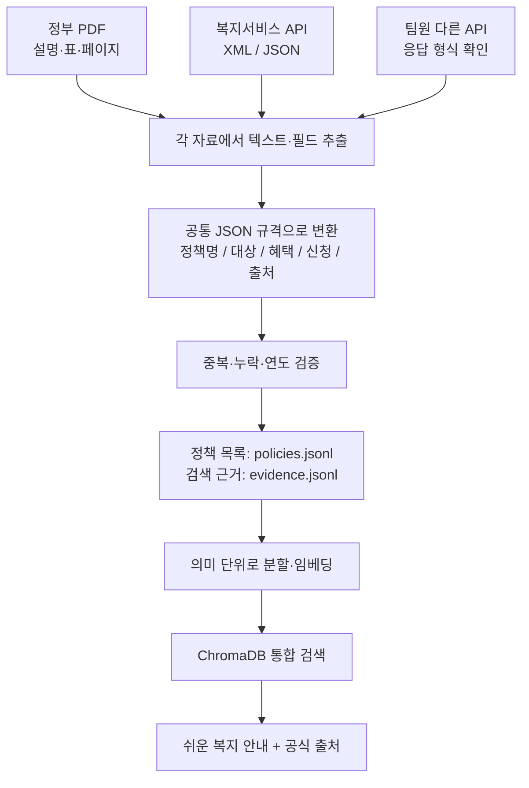
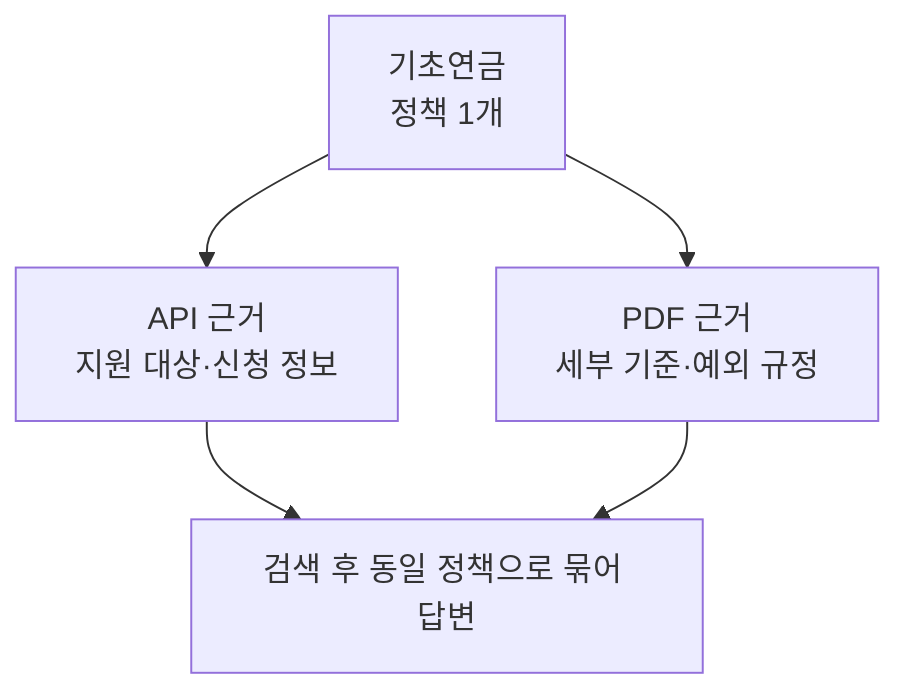

# 복지정책 RAG 데이터 통합 가이드

> **팀 공유용 | 2026.11.06 | 데이터 통합 방식 제안**  
> **결론 한 줄:** **PDF·API 원본은 그대로 보관하고, 검색에 사용할 정보만 공통 JSON 규격으로 정리하자.**

## 0. 30초 요약

| 우리가 가진 데이터 | 현재 모습 | 통합 후 |
|---|---|---|
| 정부 **PDF** | 긴 설명, 표, 목차 | 정책명·지원 대상·근거 페이지를 정리 |
| 복지서비스 **API** | XML, 목록 JSON·CSV | 정책명·지원 대상·혜택·서비스 ID를 정리 |
| 팀원 **다른 API** | 응답 형식 확인 필요 | 같은 규격에 맞게 정리 |

**비유:** 팀원들이 서로 다른 양식으로 작성한 정책 정보를 **같은 항목이 있는 공통 신청서**로 옮겨 적는 작업이다.  
**원본을 버리는 작업이 아니다.** 공통 양식으로 변환하면서 **원본과 출처도 함께 보관**한다.

---

## 1. 왜 하필 JSON일까?

가장 큰 이유는 **복지정책을 '긴 글'이 아니라 '항목별 정보'로 다루기 위해서**다.

### 예시로 바로 이해하기

**변환 전 — 자료마다 표현이 다름**

- PDF: `지원 대상: ...`, `지원 내용: ...`이 문단과 표에 섞여 있음
- API(XML): `<tgtrDtlCn>...</tgtrDtlCn>`, `<alwServCn>...</alwServCn>` 같은 태그에 들어 있음

**변환 후 — 같은 항목으로 정리** *(구조를 보여주는 예시)*

```json
{
  "policy_id": "POL-0001",
  "title": "산재근로자 사회심리재활지원",
  "eligibility": "서비스별 요건에 해당하는 산재노동자 등",
  "benefit": "재활스포츠 이용비, 심리상담 등",
  "reference_year": 2026,
  "sources": [
    {
      "type": "api",
      "external_id": "WLF00000022",
      "url": "https://www.data.go.kr/data/15090532/openapi.do"
    }
  ]
}
```

*정책명·서비스 ID·지원 내용은 수집한 API 샘플을 축약한 것이며, `POL-0001`은 설명용 내부 ID다.*

| JSON을 쓰면 좋은 이유 | RAG에서 실제로 좋아지는 점 |
|---|---|
| **정책명·조건·혜택이 구분됨** | “누가 받을 수 있나요?”와 “얼마를 지원하나요?”를 나눠 검색하기 쉬움 |
| **여러 출처를 묶을 수 있음** | 같은 정책의 PDF 설명과 API 정보를 하나로 연결 가능 |
| **출처·연도·페이지를 남길 수 있음** | 답변에 공식 근거를 보여주고 최신성 확인 가능 |
| **Python에서 다루기 편함** | 팀원별 데이터를 검사·병합하고 검색 DB에 전달하기 쉬움 |

> **오해 금지:** JSON으로 바꾼다고 AI 답변이 자동으로 정확해지는 것은 아니다. **PDF 추출 정확도, 중복 검증, 정책 기준일 확인, 검색 테스트**가 여전히 필요하다.

### JSON vs JSONL — 둘 다 쓰는 이유

- **JSON:** 정책 **1건의 정보 구조**를 표현하는 표준 양식.
- **JSONL:** 같은 JSON 객체를 **한 줄에 1건씩 저장**하는 파일. 여러 정책과 검색 문서를 모으기 편리함.
- **CSV:** 팀원 검토·통계에는 편리하지만, **신청 절차 여러 개·PDF 출처 여러 개**처럼 중첩된 정보는 JSON이 더 적합함.

---

## 2. 실제로 어떻게 합칠까? — 전체 흐름



**핵심은 두 개의 결과물을 나누는 것**이다.

| 통합 파일 | 쉽게 말하면 | 담는 내용 |
|---|---|---|
| `policies.jsonl` | **정책 목록표** | 정책 ID, 정책명, 담당 기관, 대상, 혜택, 원본 연결 |
| `evidence.jsonl` | **답변 근거 노트** | PDF의 특정 페이지, API의 선정 기준·신청 방법 등 검색할 문장과 출처 |

### 왜 정책 목록과 검색 근거를 나눌까?

예를 들어 **기초연금**을 PDF와 API가 둘 다 설명한다고 하자.



정책을 두 번 등록하지 않고 **정책 1개에 출처별 근거 여러 개를 연결**한다. 단, 정책명이 비슷하다고 바로 합치지 말고 **기관·대상·지역·연도**도 비교해야 한다.

---

## 3. 자료별로 딱 무엇을 하면 되나?

| 담당 데이터 | 해야 할 핵심 작업 | 반드시 보존할 것 |
|---|---|---|
| **PDF** | 문단·표 추출 → 사업별 분리 → 공통 필드 매핑 | **원본 PDF, 문서명, 페이지, 발행연도, URL** |
| **복지 API** | 목록+상세 `servId`로 연결 → 공통 필드 매핑 | **원본 XML, 서비스 ID, 수집일, URL** |
| **기타 API** | 실제 응답 구조 확인 → 공통 필드 매핑 | **원본 응답, 고유 ID, 수집일, URL** |
| **통합 담당** | 중복·누락·기준일 검증 → JSONL 병합 | **정책 ID 연결표와 검증 기록** |

**현재 복지 API 현황:** 목록 **461건**, 상세정보 **200건** 확보(팀 공유 수치), 잔여 **261건**. 이 숫자는 특정 API 조회 조건 기준이며, 461건 전체가 노년층 전용 정책은 아니다.

**주의할 3가지**

1. **PDF 표가 깨질 수 있음:** 금액·조건이 뒤섞이지 않았는지 원본 페이지와 비교.
2. **동일 정책의 연도별 내용이 다를 수 있음:** 임의로 하나를 지우지 말고 기준연도·적용일 확인.
3. **지원 대상이 불명확할 수 있음:** 빈 값을 AI가 추측해 채우지 않고 `null`로 보존.

---

## 4. RAG에 넣을 때의 규칙

**그냥 JSON 파일을 통째로 임베딩하지 않는다.** 실제 질문에 맞춰 필요한 내용을 쉽게 찾도록 나눈다.

- **API:** `지원 대상 / 선정 기준 / 지원 내용 / 신청 방법` 단위로 나누기.
- **PDF:** `사업명 / 장·절 / 표·예외사항` 단위로 나누기. 서로 연결된 조건은 끊지 않기.
- **모든 검색 청크:** `policy_id`, `source_type`, **원문 URL**, **기준연도**, PDF라면 **페이지** 보존.

**사용자 질문 예시:** “70세인데 생활비 지원받을 수 있나요?”  
**처리:** 관련 정책 검색 → 지원 조건 확인 → 부족한 조건 추가 질문 → 쉬운 답변 **+ 출처** 표시. **실제 수급 자격을 챗봇이 확정하지 않는다.**

---

## 5. 팀 합의 및 실행 순서

- [ ] **① 공통 필드 확정:** 정책 ID, 정책명, 대상, 기준, 혜택, 신청, 출처, 연도
- [ ] **② 소량 샘플 변환:** PDF 1개 + 각 API 5~10건으로 먼저 테스트
- [ ] **③ 데이터 병합·검증:** 동일 정책 연결, 중복·누락·충돌 확인
- [ ] **④ JSONL 생성:** `policies.jsonl` + `evidence.jsonl`
- [ ] **⑤ 검색 테스트:** ChromaDB에 적재하고 실제 질문 10개로 답변·출처 확인
- [ ] **⑥ 정상 작동 확인 후 전체 데이터로 확대**

> ### 최종 제안
> **“원본은 각각 보존, 정책 정보는 공통 JSON으로 정리, RAG 검색 문서는 JSONL로 통합.”**  
> 일단 **샘플 몇 건으로 PDF + API 통합 검색이 되는지** 확인하고, 이후 전체 데이터로 확장하자.

**참고:** [중앙부처 복지서비스 OpenAPI](https://www.data.go.kr/data/15090532/openapi.do) · [팀 데이터 출처 조사](../data-sources.md)
