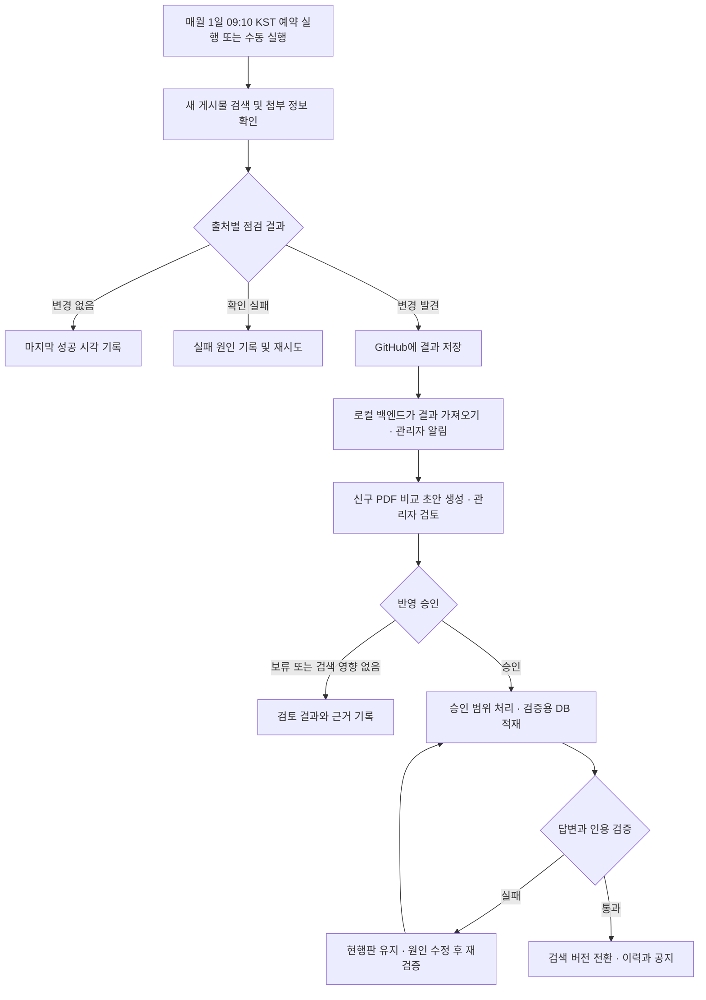

# PDF 갱신 방법

**월간 점검 → 관리자 알림 및 변경 비교 → 반영 승인 → 검색 검증 → 반영 완료·공지** 순서로 진행합니다.

## 1. 매월 1일 오전 9시 10분에 공식 출처를 점검한다

**GitHub Actions**는 GitHub의 실행 환경에서 스크립트를 예약 실행하는 기능입니다. 팀원 PC가 꺼져 있어도 돌아갑니다. 저장소 기본 브랜치에 한국시간 기준 매월 1일 09:10 예약과 수동 실행을 설정합니다. 예약이 지연될 수 있으므로 실제 점검 시각도 기록합니다. [GitHub 예약 실행 문서](https://docs.github.com/en/actions/reference/workflows-and-actions/events-that-trigger-workflows#schedule)

점검 스크립트, 출처 설정, 보고서의 위치는 [PDF 점검 파일 설명서의 폴더 구조](<PDF 점검 파일 설명서.md#pdf-점검-파일과-폴더-구조>)에 정리했습니다.

| 자료 | 탐색할 게시판과 제목 검색어 | 확인할 첨부 |
| --- | --- | --- |
| **노인보건복지 사업안내** | 정보 → 연구/조사/발간자료 → 전체에서 `노인보건복지` 검색 | 1권·2권 PDF를 각각 추적합니다. [게시판](https://www.mohw.go.kr/board.es?mid=a10411010100&bid=0019&act=list) · [2026년 게시물](https://www.mohw.go.kr/board.es?mid=a10411010100&bid=0019&act=view&list_no=1488990) |
| **기초연금 사업안내** | 정보 → 법령 → 훈령/예규/고시/지침에서 `기초연금 사업안내` 검색 | PDF 첨부와 게시일·제개정일을 확인합니다. [게시판](https://www.mohw.go.kr/board.es?mid=a10409020000&bid=0026&act=list) · [2026년 일부개정 게시물](https://www.mohw.go.kr/board.es?mid=a10409020000&bid=0026&act=view&list_no=1491527) |
| **나에게 힘이 되는 복지서비스** | 정보 → 연구/조사/발간자료 → 발간자료에서 `복지서비스` 검색 후 제목의 공백을 무시하고 자료명을 비교 | 현재 사용하는 통합 PDF를 추적합니다. 2026년 게시물에는 `힘이되는`으로 표기돼 있습니다. [게시판](https://www.mohw.go.kr/board.es?mid=a10411010300&bid=0019&act=list) · [2026년 게시물](https://www.mohw.go.kr/board.es?mid=a10411010300&bid=0019&act=view&list_no=1491341) |

- **새 게시물**은 출처별 마지막 성공 시점부터 하루 정도 겹쳐 조회합니다. 제목과 본문에서 새 연도판, 개정본, 정오표를 찾습니다. 첫 실행은 현재 서비스에 반영된 판부터 조사해 이미 나온 개정본도 찾습니다.
- **기존 게시물**은 첨부 URL·파일명·표시 용량을 확인합니다. 같은 게시물에서 이전에 확인한 첨부 정보가 일치하면 마지막 해시와 비교 결과를 재사용합니다. 새 게시물, 첨부 정보가 바뀐 게시물, 이전에 확인이 실패한 첨부는 다운로드합니다. 보건복지부가 첨부 정보를 그대로 둔 채 파일 내용만 바꾸면 이 방식으로는 감지하기 어렵습니다.
- **다운로드 검증.** 2026년 11월 19일에 게시판 3곳의 제목 검색과 PDF 4개 다운로드를 확인했습니다. 네 파일 모두 HTTP 200으로 내려왔고 PDF 형식이었으며 해시를 계산할 수 있었습니다. 예약 등록 전에 GitHub 실행 환경에서도 수동 실행으로 같은 요청을 검증합니다.

## 2. 출처별 점검 결과를 기록한다

| 결과 | 기록 및 후속 처리 |
| --- | --- |
| **변경 없음** | 확인한 출처·첨부와 점검 시각을 저장하고 마지막 성공 시점을 갱신합니다. 관리자 화면에는 최근 점검일을 보여줍니다. |
| **변경 발견** | 새 판·정오표·첨부 교체 유형과 게시물 번호, 첨부 URL·해시를 기록하고, 해당 출처를 모두 확인했다면 마지막 성공 시점을 갱신합니다. 같은 문서와 해시는 기존 검토 건에 연결합니다. |
| **확인 실패** | 실패한 출처·URL·단계·이유를 기록합니다. 예를 들어 목록 요청 시간 초과, 다운로드 HTTP 403, 첨부 링크 없음, PDF 대신 HTML 응답을 구분합니다. 일시 오류는 재시도하고, 계속 실패하면 해당 출처의 마지막 성공 시점을 유지합니다. 다른 출처는 계속 점검합니다. |

[PDF 점검 파일 설명서의 입출력과 보고서 예시](<PDF 점검 파일 설명서.md#명령줄-입출력>)

## 3. 점검 결과를 관리자 탭에 연결하고 비교 초안을 만든다

GitHub Actions는 **출처별 점검 상태와 변경 후보 목록**을 별도 결과 브랜치에 JSON으로 저장합니다. 로컬 백엔드는 앱 시작 또는 관리자 탭의 **점검 결과 가져오기**에서 이 목록을 읽어 PostgreSQL 검토함에 등록합니다. 후보 PDF는 내려받은 뒤 점검 결과와 해시가 같은지 확인하고 보관합니다. 그 사이 첨부가 다시 교체됐다면 변경 후보를 다시 확인합니다.

1. **공식 개정 안내나 정오표가 있으면** 적용 대상 판과 절을 찾고, 정정 전후 문구와 출처를 비교 초안에 붙입니다.
2. **상세 안내가 없으면** 신구 PDF에서 목차와 페이지별 텍스트를 추출합니다. 사업명·장·절 제목으로 대응 항목을 찾고 추가·삭제·수정·페이지 이동을 표시합니다. 예를 들어 같은 절이 `구판 37쪽 → 개정판 39쪽`으로 옮겼다면 본문 변경과 별도로 기록합니다.
3. **표·이미지·추출이 어려운 쪽은 검토 필요로 표시합니다.** 관리자가 신구 원본을 나란히 열어 수치, 단위, 각주, 적용 조건을 확인합니다. 해시 차이는 파일 변경을 감지하는 용도로 쓰고, 정책 영향은 이 비교에서 판단합니다.

알림에는 **현행판·후보판, 발견일, 공식 원문 링크, 변경 후보, 구판과 개정판 페이지**를 표시합니다. 비교 초안이 늦어지면 후보를 먼저 알리고, 같은 검토 건에 비교 결과를 추가합니다.

## 4. 자료별 재처리 범위를 승인한다

| 자료 | 관리자 검토 기준과 처리 범위 |
| --- | --- |
| **노인보건복지 사업안내** | 바뀐 권의 사업 항목, 표, 권 사이 참조를 확인합니다. 해당 권을 다시 추출하고 인용 페이지를 확인합니다. |
| **기초연금 사업안내** | 선정기준, 금액, 신청 절차, 표 각주를 확인합니다. 이번 개정본처럼 316쪽에서 317쪽으로 바뀌고 중간 페이지가 이동했다면 개정본 전체를 다시 추출합니다. |
| **나에게 힘이 되는 복지서비스** | 서비스명별 대상·지원 내용·신청 방법·문의처를 비교합니다. 바뀐 서비스 섹션을 처리하고, 표지나 발간 정보만 바뀌었다면 원본과 판 정보를 갱신합니다. |
| **별도 정오표** | 정오표가 적용되는 판과 절을 확인한 뒤 필요한 섹션을 수정하고 정오표를 근거로 연결합니다. |

관리자는 **전체 재처리 / 일부 섹션 재처리 / 출처·페이지 정보 갱신 / 보류** 중 하나를 선택하고 판단 근거를 남깁니다.

## 5. 검증용 DB에 적재하고 챗봇에서 확인한다

**단계는 변경 섹션 정리 → 청킹 → 기존 벡터 재사용 및 필요한 청크만 임베딩 → 검증용 DB 적재**입니다. 새 검색 버전에 전체 청크를 적재할 때는 재사용한 벡터와 새로 계산한 벡터를 함께 넣습니다.

1. **승인된 범위의 섹션을 갱신하고 다시 청킹합니다.** 새 PDF의 본문·표와 PDF 파일 기준 페이지를 추출하고, 각 섹션에 판·공식 링크·페이지 범위를 붙입니다. 문장이 추가되거나 삭제되면 뒤쪽 청크 경계도 달라질 수 있으므로 변경된 섹션 전체를 다시 청킹합니다. 본문이 유지된 섹션은 기존 청크를 사용하고, 개정판에서 페이지가 이동했다면 인용 정보를 갱신합니다. 현재 `run_step06.py`는 추출이 끝난 섹션 JSONL을 입력으로 받습니다. [현재 PDF 처리 코드](../../src/rag/pdf_processing/run_step06.py)
2. **모델에 전달되는 입력과 임베딩 설정으로 재사용 여부를 판단합니다.** 전처리한 청크 텍스트와 KURE-v1 모델 버전·설정이 같으면 기존 벡터를 가져옵니다. 페이지나 청크 ID가 바뀌어도 이 조건을 충족하면 벡터를 재사용할 수 있습니다. 새로 생기거나 임베딩 입력이 달라진 청크만 다시 임베딩합니다. 서로 다른 PDF에서 청크의 임베딩 입력과 설정이 같으면 벡터 계산 결과를 공유하고, 각 청크에는 해당 문서의 제목·판·페이지를 각각 남깁니다.
3. **새 검색 버전의 전체 청크를 검증용 Qdrant와 Neo4j에 적재합니다.** 재사용한 벡터와 새 벡터를 합치고, 개정판에서 삭제된 구판 청크는 새 검색 버전에서 제외합니다. 두 DB의 청크 ID가 같은 판을 가리키는지 확인하고, 챗봇에 대표 질문을 보내 개정 내용·공식 링크·인용 페이지를 검증합니다. 두 DB 모두 통과하면 같은 판으로 전환합니다. 실패하면 현행판을 계속 사용하면서 오류를 수정합니다.

| 개정 전후 예시 | 처리 |
| --- | --- |
| 신청 절차 문구는 같고 37쪽에서 39쪽으로 이동 | 기존 벡터 재사용, 개정판 출처와 인용 페이지 갱신 |
| 선정기준 표의 수치가 바뀜 | 해당 섹션을 다시 청킹하고, 입력이 바뀐 청크만 임베딩 |
| 새 예외 조항이 추가됨 | 새 청크를 만들고, 기존 벡터가 없는 입력은 임베딩 |
| 구판 조항이 삭제됨 | 해당 청크를 새 검색 버전에서 제외 |

## 6. 반영 완료를 기록하고 필요한 변경을 공지한다

검색 전환이 끝나면 관리자 탭을 **반영 완료**로 바꾸고, 검수자·반영 판·반영일·검증 결과를 남깁니다. 사용자 답변에 영향이 있는 변경은 바뀐 내용과 공식 출처를 공지합니다.

첫 시연은 **기초연금 개정본 한 권**으로 수동 점검부터 챗봇의 개정판 인용 확인까지 진행합니다. 그 흐름을 검증한 다음 월간 예약을 연결합니다.
