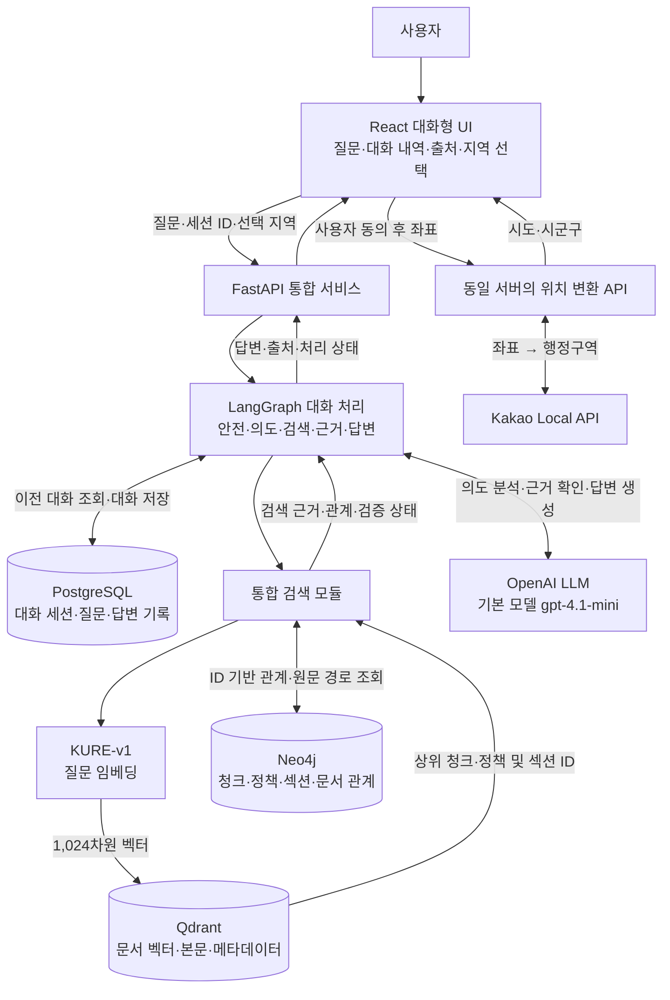
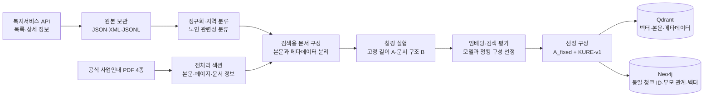
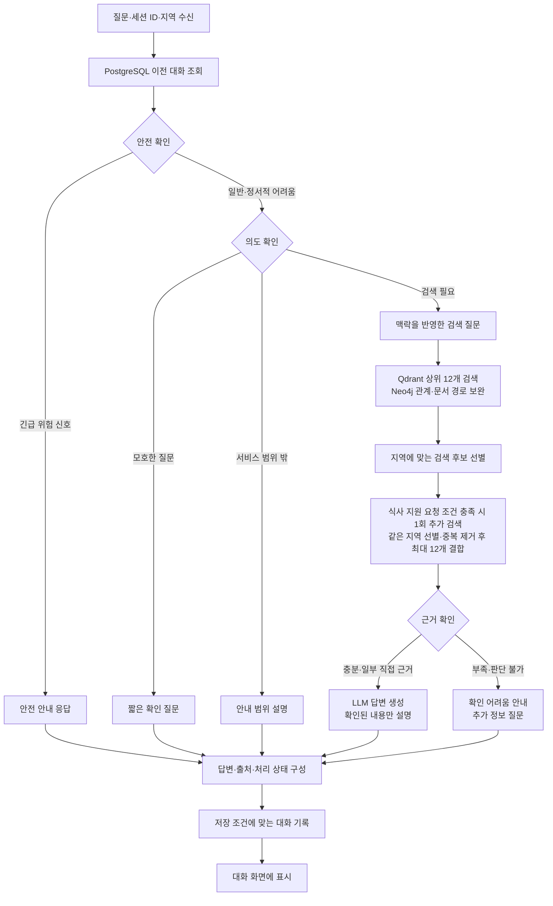
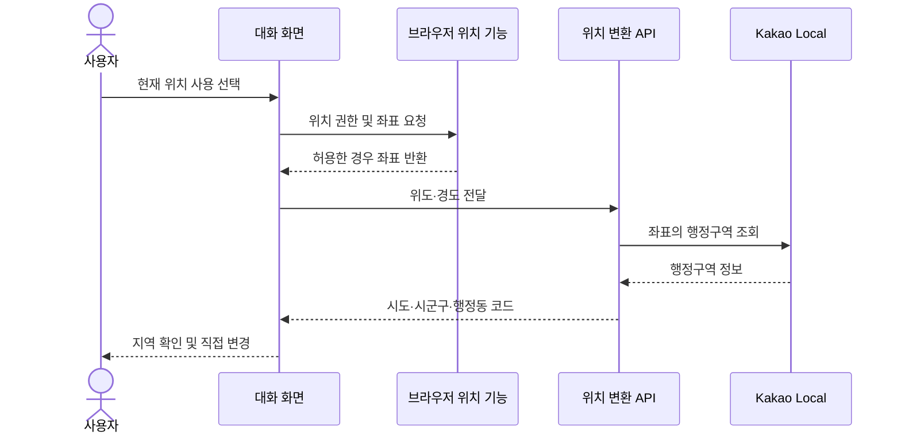

# 어르신 복지 안내 챗봇 시스템 아키텍처

**프로젝트:** SKN36-3rd-3Team  
**작성일:** 2026년 11월 11일  
**최종 갱신:** 2026년 11월 12일, 통합 `dev` 커밋 `397e31b` 기준  
**문서 범위:** 데이터 구축부터 대화형 서비스까지의 통합 구현 구조

> 본 문서는 프론트엔드와 백엔드가 병합된 `dev`의 구현을 기준으로 서비스 구성을 설명한다. 코드에서 확인한 연결 구조와 실제 실행 검증 결과는 구분하며, 이번 갱신에서는 서버·DB를 실행하지 않았다. 사용자 인증, 자동 백업 등 아직 도입하지 않은 운영 기능과 남은 통합 과제는 별도로 명시했다.

## 1. 시스템 개요

### 1.1 서비스 목적

이 서비스는 복지제도 이름이나 신청 절차를 알기 어려운 어르신에게 필요한 지원을 쉬운 말로 안내하는 대화형 챗봇이다. 사용자는 “돈이 없어 밥을 못 먹겠어요”와 같이 일상적인 표현으로 질문하고, 챗봇은 상황에 맞는 정책과 사업 안내 자료를 찾아 지원 내용과 신청 방법을 설명한다.

질문이 모호하면 바로 정책을 추천하지 않고 짧은 확인 질문을 한다. 이어지는 대화에서는 앞서 사용자가 대화에서 밝힌 어려움이나 거주 지역을 참고한다. 화면에서 선택한 지역도 요청에 함께 전달하며 검색 후보를 선별하는 데 사용한다. 답변에는 검색에 사용한 정책·문서의 출처를 함께 제공하며, 자료만으로 확인하기 어려운 자격이나 지원 가능 여부를 임의로 확정하지 않는다.

핵심 구조는 **문서를 미리 검색 가능한 형태로 만드는 데이터 구축 과정**과 **질문에 맞는 근거를 찾아 답변하는 대화 처리 과정**으로 나뉜다. 문서 임베딩은 데이터 구축 시 계산해 보관하고, 대화 중에는 검색할 질문의 임베딩만 계산한다.

### 1.2 구성 원칙

| 구분 | 설계 방향 |
|---|---|
| 사용자 화면 | 말풍선으로 질문과 답변을 이어 보여주고, 어려운 입력은 쉬운 답변 선택지로 보조한다. 위치 권한은 선택 사항으로 둔다. |
| 대화 처리 | 안전 확인, 질문 의도 확인, 검색, 근거 확인, 답변 생성을 순서와 조건에 따라 실행한다. |
| 검색 | Qdrant에서 의미가 가까운 문서를 찾고, 문서의 식별자로 Neo4j 관계와 원문 경로를 조회한다. |
| 기록 | PostgreSQL에 대화 세션과 질문·답변을 보관하고, 이어지는 질문의 맥락을 파악할 때 불러온다. |
| 답변 | LLM에 검색 근거와 필요한 이전 대화만 전달한다. 근거가 부족하면 추가 정보를 묻거나 확인이 어렵다고 안내한다. |

이 구조에서 ‘Hybrid RAG’는 **벡터 검색 결과에 그래프의 관계·출처 정보를 보완하는 방식**을 뜻한다. 두 DB의 검색 점수를 합산하거나, 그래프 관계만으로 수급 자격을 판정하는 구조는 아니다.

## 2. 전체 시스템 아키텍처

### 2.1 통합 구성도

화면은 질문과 세션 ID, 선택 지역을 API로 전달한다. API는 대화 처리 모듈을 실행하고, 결과를 답변·출처·처리 상태·선택지로 나누어 반환한다. `frontend/`의 HTTP 어댑터가 실제 API를 호출하고 서버 필드 이름을 화면 형식으로 변환한다. `backend/`의 통합 FastAPI 앱은 채팅, 위치 변환, 정책 검색·상세, 세션 조회·삭제를 한 진입점에 등록한다. 개발 환경에서는 Vite가 `/api` 요청을 8000번 포트의 통합 서버로 전달한다.

주요 API는 `POST /api/chat`, `POST /api/location/region`, `POST /api/ask`, `GET /api/policies/{policy_id}`, `GET /api/sessions/{session_id}/history`, `DELETE /api/sessions/{session_id}`다. 서버에 API가 있다는 것과 모든 화면이 해당 API를 사용한다는 것은 구분한다. 채팅과 위치 변환은 HTTP 호출 경로가 연결되어 있지만, 정책 검색·상세와 기록 관리 화면은 추가 정리가 필요하다.

PostgreSQL은 현재 서비스에서 대화 기록을 담당한다. 정책·PDF의 검색 근거는 Qdrant와 Neo4j에서 조회하며, PostgreSQL의 정책 테이블을 거쳐 검색하는 구조는 아니다. 저장소에는 과거 정책 적재용 스키마와 도구가 남아 있지만, 이를 현재 통합 서비스의 정책 저장·검색 경로로 포함하지 않는다.

### 2.2 구성 요소와 선택 근거

| 구성 요소 | 역할과 사용 이유 |
|---|---|
| React·TypeScript·Vite·Tailwind CSS | 대화 내역, 입력 상태, 지역 선택, 출처 카드 등을 구성한다. TypeScript로 화면과 API 사이의 데이터 형태를 명시한다. |
| FastAPI | 질문과 좌표 요청의 형식을 검사하고, 내부 처리 결과를 일정한 응답 형식으로 제공한다. |
| LangGraph | 대화의 현재 정보를 상태로 전달하면서, 모호한 질문이나 근거 부족 등 상황에 따라 처리 경로를 나눈다. |
| LangChain 및 모델 연동 라이브러리 | 임베딩 모델, 벡터 저장소, LLM 호출을 연결한다. |
| KURE-v1 | 문서와 질문을 같은 의미 공간의 벡터로 변환한다. 프로젝트 검색 실험 결과를 근거로 채택했다. |
| Qdrant | 문서 벡터를 저장하고 질문 벡터와 가까운 청크를 찾는다. 지역·문서 종류 등의 메타데이터 검색을 위한 인덱스도 보관한다. |
| Neo4j | 검색된 청크가 어느 정책·섹션·PDF에 속하는지 추적한다. 정책 간 관계 확장은 검토·승인된 관계를 적재한 뒤 사용한다. |
| PostgreSQL 16 | 대화 세션과 메시지를 관계형 테이블로 보관하고, 이전 대화 조회·문답 저장·대화 삭제를 처리한다. |
| OpenAI LLM | 질문 의도 분석, 검색 근거의 충분성 확인, 어르신이 이해하기 쉬운 답변 작성을 수행한다. 기본 모델은 환경변수로 변경할 수 있다. |
| Docker Compose | 개발 환경의 세 DB를 실행하고, 컨테이너와 저장 데이터를 분리해 관리한다. |

KURE-v1은 검색용 모델이며 자연어 답변을 작성하지 않는다. 반대로 LLM은 검색할 문서 전체의 벡터를 대화마다 다시 만들지 않는다. 두 모델의 역할을 분리해 검색 품질과 답변 품질을 각각 확인할 수 있도록 구성했다.

## 3. 데이터 구축 파이프라인

### 3.1 수집부터 적재까지

이 과정은 사용자가 질문할 때마다 실행하지 않는다. 정책이나 문서가 추가·변경될 때 데이터를 구축하고, 대화 처리에서는 적재된 검색 자료를 사용한다. 현재 구축 작업은 노트북과 실행 스크립트 중심이며, 주기적인 자동 수집·배포 작업은 별도 운영 과제다.

### 3.2 원천 데이터와 정규화

복지서비스 API에서 정책 목록과 상세 정보를 수집해 사업명, 지원 대상, 선정 기준, 지원 내용, 신청 방법, 담당 부서, 문의처, 지역, 출처 URL 등을 정리한다. 수집 모듈은 페이지와 서비스 ID에 따른 캐시 및 호출 한도를 두어 불필요한 재요청을 줄인다. 실제 외부 API의 남은 일일 호출량까지 자동으로 조회하는 구조는 아니다.

지역 명칭과 날짜 형식을 통일한 뒤 대상 지역 후보를 분류하고, 노인 관련성을 직접 관련·간접 관련·검토 필요·제외 후보로 나눈다. 자동 분류 결과와 사람이 확인한 결과는 구별한다. 예를 들어 지역 후보에 포함되었다고 해서 해당 지역 주민의 신청 자격까지 검증된 것은 아니며, 별도의 검증 상태를 메타데이터로 유지한다.

PDF 자료는 「2026년 기초연금 사업안내」, 「2026 나에게 힘이 되는 복지서비스」, 「2026 노인보건복지사업안내」 1·2권이다. 전처리된 섹션의 본문과 원본 문서 ID, 페이지 범위 등을 검사해 검색용 문서로 만든다. 이 단계의 처리 코드는 이미 추출된 섹션을 입력받으므로, 모든 PDF의 추출·표 복원·페이지 검수가 자동으로 완료되었다는 의미는 아니다.

시설 위치 데이터의 수집 자료도 저장소에 있지만, 현재 선정된 Qdrant 컬렉션의 3,400개 청크에는 시설 검색 자료가 포함되지 않는다. 시설 안내와 지도 표시는 정책 검색과 구분해 확장한다.

### 3.3 청킹과 식별자 생성

검색용 문서는 본문과 메타데이터를 분리한다. 본문에는 정책의 주요 항목이나 PDF 섹션 내용이 들어가고, 메타데이터에는 정책·문서 ID, 지역, 문서 종류, 출처, 페이지 범위, 검증 상태 등이 들어간다.

청킹은 긴 문서를 검색에 사용할 작은 조각으로 나누는 과정이다. 비교한 두 방식은 다음과 같다.

| 구성 | 분할 방식 | 정책 청크 | PDF 청크 | 합계 |
|---|---|---:|---:|---:|
| A_fixed | 최대 800자, 인접 구간 150자 중복 | 662 | 2,738 | 3,400 |
| B_structure | 정책 항목·PDF 문단과 줄 경계를 우선하며 긴 구간을 추가 분할 | 675 | 3,190 | 3,865 |

두 구성의 입력은 정책 문서 574건과 PDF 섹션 1,189건이다. B 구성도 기본 크기 800자와 중복 매개변수 150자를 사용하지만, 모든 문단 사이에 일률적으로 150자를 겹치는 방식은 아니다.

각 청크에는 문서 종류, 부모 ID, 분할 방식, 순번을 결합한 `chunk_id`를 부여한다. 이 값을 UUID5로 변환한 ID를 Qdrant 포인트와 다른 DB의 청크 식별에 공통으로 사용한다. 같은 입력과 분할 방식으로 다시 만들면 동일한 ID를 얻는다.

### 3.4 임베딩 선정 근거

최종 검색 비교는 2026년 11월 10일 실행한 질문 세트 v3를 기준으로 한다. 전체 122문항 중 정답이 지정된 113문항을 검색 지표로 평가하고, 함정·근거 없음 확인용 9문항은 별도로 다뤘다. 두 청킹 구성에 KURE-v1과 Ollama의 qwen3-embedding:0.6b를 각각 적용했다.

| 청킹·모델 구성 | Hit@5 | Recall@5 | MRR@5 |
|---|---:|---:|---:|
| **A_fixed · KURE-v1** | **0.885** | **0.850** | **0.765** |
| B_structure · KURE-v1 | 0.858 | 0.816 | 0.713 |
| A_fixed · qwen3-embedding:0.6b | 0.770 | 0.722 | 0.606 |
| B_structure · qwen3-embedding:0.6b | 0.779 | 0.732 | 0.596 |

Hit@5는 상위 5개 안에 정답이 하나 이상 포함된 질문의 비율, Recall@5는 지정된 정답 중 상위 5개가 찾아낸 비율의 질문별 평균, MRR@5는 첫 정답의 순위가 앞설수록 높아지는 지표다. 이 결과에서 KURE-v1의 A 구성이 가장 높은 값을 보여 **A_fixed + KURE-v1**을 DB 구축 기준으로 선택했다.

이 수치는 최종 답변의 정확도나 모든 사용자 질문에 대한 성공률이 아니다. 해당 자료와 정답 세트에서 측정한 검색 성능이다. 평가에는 지역 필터를 사용했고, qwen 구성은 Q8_0 양자화 및 별도 지시문을 붙이지 않은 조건이었다. 따라서 모델 자체의 보편적인 우위를 증명하는 결과로 해석하지 않는다. 합성 질문의 편향도 고려해야 하며, 실제 사용자 표현과 팀원이 독립적으로 만든 질문으로 추가 평가가 필요하다.

문서 임베딩은 Runpod의 RTX 4090 환경에서 계산한 벡터를 재사용했다. 모델은 `nlpai-lab/KURE-v1`, 리비전은 `8b418a58414668e75532ed045c22d9ca018ae2b2`이며, 1,024차원·정규화 벡터·Cosine 유사도를 사용한다. 질문 임베딩도 같은 모델과 리비전, 정규화 조건을 유지해야 한다. GPU 실험 시간을 일반 PC의 응답 시간으로 간주하지 않는다.

> 저장소의 `data/rag/archive/v3`는 별도의 과거 데이터 준비 산출물이다. 그 폴더의 10,520개 청크나 10,337개 임베딩 후보를 현재 적재량으로 사용하지 않는다. 여기서 설명하는 ‘질문 세트 v3’와 데이터 폴더의 ‘v3’는 서로 다른 버전 구분이다.

### 3.5 DB 적재와 인덱스

Qdrant 컬렉션 `welfare_chunks_v1`에는 선택된 3,400개 벡터와 함께 본문을 `page_content`, 부가 정보를 `metadata`에 저장한다. 문서 종류·부모 ID·시도·시군구의 네 항목에는 필터 조회를 위한 키워드 인덱스를 둔다. 현재 채팅 검색은 이 지역 인덱스로 검색 범위를 먼저 제한하지 않고, 벡터 검색으로 받은 후보를 애플리케이션에서 지역별로 선별한다. 노트북 평가의 검색 전 필터와 서비스의 검색 후 선별을 동일한 방식으로 간주하지 않는다.

Neo4j에는 동일한 청크 ID와 벡터를 보관하고, 청크를 정책 또는 PDF 섹션에 연결한다. PDF 섹션은 원본 PDF 문서에 연결한다. 노트북에서는 Neo4j의 1,024차원 Cosine 벡터 인덱스 생성과 검색도 확인했다. 다만 기본 채팅 검색은 Qdrant를 시작점으로 사용한다.

문서 구축의 적재 대상은 Qdrant와 Neo4j다. 두 저장소가 같은 청크 집합과 식별자를 사용하는지 대조해야 하며, 한 DB만 새 버전으로 바꾸면 문서 관계 조회가 어긋날 수 있다. PostgreSQL의 대화 테이블은 이 문서 적재 과정과 분리하여 준비한다.

## 4. 사용자 질문 처리 흐름

### 4.1 대화 처리와 분기

이 흐름은 정해진 처리 노드와 조건 분기로 구성한다. 여러 자율 에이전트가 도구를 반복 선택하는 Supervisor 방식은 사용하지 않는다. 식사·도시락·반찬 등의 표현과 지원 필요·도움 요청 등의 조건을 함께 만족하면, 첫 검색 결과가 있어도 식사 지원에 초점을 맞춘 질문으로 한 번 추가 검색한다. 예를 들어 “도시락을 지원받고 싶어요”도 대상이 될 수 있다. 추가 질문이 처음 검색 질문과 같으면 중복 호출하지 않는다.

두 검색 결과에는 같은 지역 선별을 적용한다. 추가 검색에서 남은 후보가 있으면 그 결과를 앞에 두고 기존 결과를 이어 붙인 뒤 청크 ID 등으로 중복을 제거해 최대 12개를 유지한다. 추가 검색에서 후보를 얻지 못하면 기존 결과를 유지한다. 남긴 문서의 정책 관계와 PDF 경로도 함께 보존하며, 유사도 점수나 검증 상태를 임의로 높이지 않는다. 이는 검색 순위를 RRF로 계산하는 방식이 아니라, 목표가 구체적인 추가 검색 결과를 먼저 배치하는 방식이다.

### 4.2 입력과 대화 기억

질문 API의 입력은 `question`, 선택적인 `session_id`, 선택적인 `region`이다. 지역은 전국 선택 또는 시도·시군구로 구분한다. 질문은 공백만 있는 값을 허용하지 않고 최대 2,000자로 제한하며 세션 ID는 UUID 형식을 사용한다. 응답은 `answer`, `sources`, `safety_status`, `answer_status`, `session_id`, `choices`로 구성한다.

통합 채팅 서비스는 `mock=False`, `memory_enabled=True`로 그래프를 호출한다. PostgreSQL에서 같은 세션의 최근 메시지를 최대 8개 읽어 대화 상태에 넣고, 새 대화이면 UUID를 발급한다. LLM의 의도 분석에는 최근 메시지 중 최대 6개, 답변 생성에는 최대 4개를 잘라 전달한다. 전체 대화를 무제한으로 보내거나 사용자의 모든 정보를 영구적으로 기억하는 방식은 아니다.

공용 그래프는 기억을 켜거나 끄는 호출을 지원하지만 통합 채팅 API는 기억을 켜도록 고정한다. 따라서 `.env.example`의 `CHAT_API_MOCK`·`CHAT_MEMORY_ENABLED`만 바꿔서는 새 API의 동작이 달라지지 않는다. 기존 API와 통합 API의 실행 방법·설정을 구분하고, PostgreSQL 접속 정보와 대화 테이블을 먼저 준비해야 한다. 기억 활성화 여부를 화면에 명시하는 응답 필드는 후속 계약 정리 사항이다.

예를 들어 사용자가 먼저 식사 문제를 설명하고 “돈이 없어서요”라고 답하면, 의도 분석은 앞선 발화를 함께 참고해 검색 문장을 만든다. 이후 “신청은 어디서 해요?”라는 질문도 같은 세션 안에서 앞선 정책 안내와 연결해 해석한다. 반면 지역·나이·소득을 사용자가 말하지 않았다면 임의로 채워 넣지 않는다.

문답은 일반 안전 상태이면서 답변 결과가 성공 또는 근거 없음인 경우에 저장한다. 명시적인 긴급 위험 신호나 정서적 어려움으로 분류된 대화는 기본 저장 대상에서 제외한다. 저장하는 사용자 질문과 챗봇 답변은 하나의 트랜잭션으로 기록한다.

### 4.3 안전 확인과 의도 분석

안전 확인은 규칙 기반으로 명시적인 위험 표현을 구분한다. 긴급 위험으로 판단하면 복지 문서 검색보다 안전 안내를 우선하고, 정서적 어려움은 공감 표현과 함께 다음 처리를 진행한다. 이는 제한된 표현을 대상으로 한 보조 장치이며 전문적인 위험 진단을 대신하지 않는다.

의도 분석은 LLM을 사용해 질문을 검색 필요, 추가 확인 필요, 서비스 범위 밖으로 나눈다. “배고파요”처럼 상황을 단정하기 어려운 입력에는 “식사할 음식이 없으신가요?”와 같은 확인 질문을 먼저 제시한다. 의도 분석의 응답 형식이 잘못되거나 호출에 실패하면 일반적인 확인 질문으로 대응한다.

화면의 쉬운 답변 버튼은 해당 챗봇 말풍선 아래에 배치하고, 자유롭게 이어 물을 수 있는 입력칸도 유지한다. 서버는 확인 질문의 번호 선택지를 추출해 `choices`로 반환하고, 화면은 유효한 서버 선택지가 두 개 이상이면 우선 사용하며 그렇지 않으면 답변의 번호 문장을 해석한다. 선택한 문장은 같은 세션의 다음 사용자 발화로 보낸다. 버튼을 누를 때마다 새 세션을 만들면 이전 맥락이 사라지므로 세션 유지가 필요하다.

선택지는 사용자가 밝히지 않은 가족 구성이나 소득을 단정하지 않는 표현으로 작성한다. UI 내부 예시는 실제 자격 판정 결과와 구분한다. 현재 화면의 선택지 추출은 질문 본문의 번호 형식도 확인하므로, 향후 번호 문장 없이 `choices`만 반환하는 응답도 지원할지 계약을 정리해야 한다.

현재 확인 질문, 서비스 범위 밖, 근거 부족, 근거 판단 불가는 모두 `answer_status=no_evidence`로 반환한다. 확인 질문에 선택지가 있으면 이를 구별할 수 있지만 상태값만으로 모든 사유를 구분할 수는 없다. 필요한 경우 별도 사유 필드를 추가한다.

### 4.4 검색 결과의 결합과 근거 확인

검색 질문은 KURE-v1으로 벡터화한 뒤 Qdrant에 전달한다. 채팅의 기본 검색은 가까운 청크 최대 12개와 본문, 유사도, 출처 정보를 받는다. 통합 검색 모듈은 정책의 경우 `policy_id`로 Neo4j의 정책과 관계를 조회하고, 지침의 경우 `chunk_id`와 `section_id`로 섹션과 원본 PDF 경로를 확인한다. 지역에 맞지 않는 후보와 연결 근거는 함께 제외한다.

검색 결과를 모을 때는 빈 본문, 잘못된 식별자, 중복 청크, 부모 ID 불일치 등을 검사한다. 출처 URL이 없는 자료는 URL을 만들어 채우지 않는다. 이러한 검사는 자료 구조의 일관성을 확인하는 것으로, 정책 내용의 최신성이나 개인의 수급 자격을 공식 검증하는 과정은 아니다.

그다음 중복 청크를 제거하고 같은 PDF 섹션은 최대 두 개까지 유지해 근거 문서를 최대 8개 고른다. LLM은 원래 질문과 검색 질문, 선택 지역과 문서 본문을 보고 근거를 충분·일부 직접 근거·부족·판단 불가로 나눈다. 충분하거나 일부 직접 근거가 있으면 확인되는 범위에서 답변을 생성하고, 나머지는 추가 정보를 묻거나 확인이 어렵다고 설명한다. 일부 근거만 있는 경우 확인되지 않은 금액·조건·신청 방법은 추측하지 않도록 지시한다. 이 판단 역시 모델의 평가이므로 최종 사실 검증을 완전히 보장하지 않는다.

서비스는 검색별 최대 12개 후보를 받고, 식사 지원 추가 검색 결과와 결합할 때도 최대 12개를 유지한 뒤 문맥을 최대 8개 선택한다. 이 설정은 임베딩 비교 실험의 Top-5와 다르다. 따라서 과거 Hit@5·MRR@5를 현재 전체 대화 경로의 성능으로 그대로 적용하지 않는다.

### 4.5 답변과 출처 제공

답변 생성에는 현재 질문, 필요한 이전 대화, 선택 지역, 최대 8개 검색 문서, 정책 관계의 요약 정보, PDF 출처 경로와 검증 경고를 전달한다. 정책 관계 정보는 ID·존재 여부·제목 위주로 축약해 큰 벡터 속성을 그대로 넣지 않는다. 프롬프트는 쉬운 존댓말, 필요한 내용 위주의 짧은 설명, 근거에 없는 금액·전화번호·신청 방법 생성 금지를 지시한다. 그래프 관계만으로 자격을 확정하지 않고, 검색 자료의 지역을 사용자의 거주지로 간주하지 않도록 한다.

답변의 출처는 실제 답변 문맥으로 선택한 문서의 메타데이터에서 구성한다. 정책·문서 제목, 부모 ID, 청크 ID, URL, PDF 페이지 범위 등을 제공하며, 값이 없는 항목은 확인된 것처럼 표시하지 않는다. 현재 출처 목록은 검색 자료 단위이므로 각 답변 문장과 출처가 일대일로 검증되었다는 뜻은 아니다. 지역 검증 상태는 데이터의 `region_selection_verified`와 응답의 `region_verified` 사이의 매핑을 맞춰야 하며, 필드가 다르다는 이유로 검증 결과가 누락되지 않도록 통합 시험에 포함한다.

일반적인 검색 응답에서는 의도 분석, 근거 판단, 답변 작성에 각각 LLM 호출이 발생할 수 있다. 확인 질문으로 끝나면 뒤의 검색과 생성은 생략한다. 기본 API는 완성된 답변을 한 번에 반환하며 토큰 스트리밍을 전제로 하지 않는다.

### 4.6 위치 정보와 지역 조건

위치 사용은 사용자 선택으로 제공한다. 사용자가 위치 버튼을 누르고 브라우저 권한을 허용하면 좌표를 위치 변환 API로 보내고, 서버가 Kakao Local API로 행정구역을 조회한다. 카카오 REST 키는 서버 환경변수에서 읽으며 브라우저에 내려보내지 않는다.

현재 위치는 실제 거주지와 다를 수 있으므로 사용자가 확인하거나 직접 지역을 선택할 수 있게 한다. 권한을 거절하거나 조회에 실패해도 대화를 계속할 수 있어야 한다. 지역 검색에는 원시 좌표보다 확인한 시도·시군구를 사용한다.

선택 지역은 채팅 요청의 `region`으로 매번 전달하며, 질문 의도·근거 판단·답변 프롬프트와 검색 후 선별에 사용한다. 현재 지역은 대화 테이블에 별도 저장하지 않는다. 카카오에서 받은 행정동 코드와 시 단위로 정리한 시군구 코드는 서로 다를 수 있어 같은 코드로 취급하지 않는다.

채팅의 지역 선별은 검색한 후보 안에서 수행한다. 전국 스코프 자료와 지역이 명시되지 않은 지정 공식 안내서는 유지하고, 지역 정책은 시도가 일치해야 한다. 시군구를 선택한 경우 해당 시군구 자료와 시도 단위임이 명시된 자료를 유지하며, 지역을 판별할 수 없는 자료를 임의로 전국 공통으로 취급하지 않는다. 이때 정책 관계 확장 후보는 별도의 지역 검증이 없어 제외한다. 전국 선택 또는 지역 미전달은 기존의 지역 제한 없는 검색으로 처리하므로, 전국 공통 정책만 검색한다는 의미는 아니다.

검색 후 선별은 다른 지역 자료가 먼저 상위 후보를 차지하면 필요한 지역 자료를 놓칠 수 있다. Qdrant의 검색 전 필터로 전환할지 평가해야 하며, 화면의 지역 목록이 아직 모두 ‘준비 중’으로 제공되는 표시와 서버의 지역 처리도 일치시켜야 한다.

## 5. 핵심 모듈과 데이터베이스 설계

### 5.1 세 DB의 책임 분담

| 저장소 | 주요 데이터 | 대화 처리에서의 역할 |
|---|---|---|
| Qdrant | 청크 벡터, 본문, 정책·섹션 ID, 지역·출처 등 메타데이터 | 질문과 의미가 가까운 문서 청크를 찾는 기본 검색 경로 |
| Neo4j | 정책, 청크, PDF 섹션·문서와 관계; 동일 청크의 임베딩 | Qdrant 결과의 정책 관계와 출처 경로 보완; 별도 벡터 검색 실험 지원 |
| PostgreSQL | 대화 세션과 사용자·챗봇 메시지, 생성·갱신 시각 | 이전 대화 조회·문답 저장·세션 삭제. 정책 검색·문서 적재와 분리 |

PostgreSQL은 `chat_sessions`와 `chat_messages` 두 대화 테이블을 사용한다. 세션에는 UUID와 생성·갱신 시각을, 메시지에는 발화자·본문·작성 시각과 세션 ID를 저장한다. 세션 삭제 시 메시지도 삭제하도록 외래키를 두며, 문답 한 쌍은 같은 트랜잭션으로 기록한다. LangGraph의 전체 상태나 문서 벡터를 저장하는 방식은 아니다.

서버는 대화 기록 조회 API와 삭제 API를 제공한다. 기록 조회는 최대 40개 메시지를 시간순으로 반환한다. 현재 프론트의 ‘새로 시작’은 로컬 대화와 식별자를 초기화하며 서버 삭제 API를 호출하지 않는다. 새로고침 후 전체 과거 말풍선을 복원하는 화면 연결도 별도로 필요하다.

### 5.2 DB를 연결하는 식별자

| 식별자 | 의미 | 사용 위치 |
|---|---|---|
| `policy_id` | 정책의 공통 ID. 예: `local:WLF…` | 정책 원본, Qdrant 메타데이터, Neo4j 정책 조회 |
| `document_id` | 원본 PDF 한 권의 ID | 지침 메타데이터와 Neo4j PDF 문서 |
| `section_id` | PDF 안의 전처리 섹션 ID | 지침 본문과 청크의 부모, Neo4j 섹션 |
| `parent_id` | 청크가 속하는 정책 또는 섹션 ID | 두 종류의 문서를 공통 형식으로 연결 |
| `chunk_id` | 문서 종류·부모·청킹 방식·순번으로 만든 청크 ID | 청크 대조, 원문 추적, Neo4j 청크 조회 |
| `id` / `point_id` | `chunk_id`에서 UUID5로 생성한 값 | Qdrant 포인트와 Neo4j 청크의 공통 식별 |
| `session_id` | 한 대화의 UUID | 화면의 대화 유지와 PostgreSQL 메시지 조회 |

정책 검색은 Qdrant 청크의 `parent_id`를 Neo4j의 `policy_id`와 연결한다. 지침 검색은 청크 → 섹션 → 원본 PDF 순서로 출처를 추적한다. 정책 ID의 접두어를 임의로 제거하면 다른 정책을 조회하거나 연결에 실패할 수 있으므로 전체 값을 보존한다.

Neo4j 적재 노트북에서 확인한 기본 문서 관계는 `청크 -CHUNK_OF→ 정책/섹션`, `원본 PDF -HAS_SECTION→ 섹션`이다. 정책 사이의 추천 관계는 이 문서 소속 관계와 구분한다. 검토·승인된 정책 간 관계의 적재는 확인되지 않았으므로, 해당 관계가 이미 준비되어 있다고 전제하지 않는다.

### 5.3 Neo4j 검색의 적용 범위

Neo4j 적재 노트북에서는 청크 임베딩을 저장하고 `rag_a_fixed_kure_v1_embedding` 벡터 인덱스를 구성해 Top-5 조회를 확인했다. 따라서 Neo4j가 벡터를 보관하지 않는 시스템이라고 설명하는 것은 맞지 않는다.

다만 기본 채팅 경로에서는 **Qdrant 벡터 검색 → Neo4j ID 기반 관계 조회**를 수행한다. 검색 모듈의 비교용 `graph` 모드는 속성의 키워드 포함 여부를 이용하는 초기 기준선이며, 노트북의 Neo4j 벡터 검색과 동일하지 않다. Neo4j 단독 검색을 최종 답변까지 연결하는 비교 실험은 결과 형식과 근거 확인 경로를 별도로 맞춰야 한다.

최신 Neo4j 검색 모듈에는 여러 청크 ID를 받아 부모 정책·섹션, 원본 PDF ID, 출처 URL과 페이지 범위를 한 번에 조회하는 근거 조회 메서드가 추가됐다. 기존 `CHUNK_OF`·`HAS_SECTION` 관계를 따라 실제 저장값을 반환한다. 다만 현재 채팅·백엔드 경로에는 이 새 메서드를 호출하는 코드가 확인되지 않아, 기본 채팅의 근거 조회가 이 방식으로 교체됐다고 설명하지 않는다.

ABC 검색 평가를 수정하는 [PR #31](https://github.com/SKNETWORKS-FAMILY-AICAMP/SKN36-3rd-3Team/pull/31)은 이번 확인 시점에 미병합 상태다. 해당 PR에서 제안한 Qdrant·Neo4j 순위의 RRF 결합은 이 문서의 기준 `dev`와 기본 채팅 검색에 포함하지 않는다.

승인된 정책 관계를 이용한 확장은 기본적으로 비활성화한다. 승인된 관계가 없으면 확장 결과는 빈 목록이다. 관계를 적재하고 확장을 켜더라도 후보를 원래 검색 근거와 구분해 유지하며, 연결 근거 없이 관련 정책을 추가하지 않는다. 그래프 확장의 연결 개수 점수와 Qdrant의 벡터 유사도는 의미가 달라 그대로 더하지 않는다. 그래프 추가가 답변 품질을 개선하는지는 별도의 비교 평가로 확인한다.

## 6. 보안과 접근 권한

### 6.1 적용된 조치와 보완 범위

| 항목 | 구현에 반영된 조치 | 운영 전에 보완할 사항 |
|---|---|---|
| 비밀정보 | `.env`를 Git 추적에서 제외하고 환경변수로 외부 서비스 키를 읽는다. 위치 키는 서버에서만 사용한다. | 공유 Compose의 개발용 인증값을 제거하고, 노출 이력이 있는 키는 교체한다. 운영 비밀값은 배포 환경에서 관리한다. |
| 요청 검사 | 질문 길이·세션 UUID·좌표 범위를 검사한다. SQL과 주요 Cypher 조회는 매개변수를 사용한다. | 요청 빈도·동시 실행 제한, 세션별 접근 검사, 사용자 입력의 민감정보 처리 기준을 추가한다. |
| 오류 응답 | 채팅의 일반 내부 예외는 503 안내로, 값 오류는 400으로, 요청 형식 오류는 422로 반환한다. 위치 API는 외부 인증 응답과 키를 그대로 반환하지 않는다. | 값 오류의 원문과 기본 422 검증 응답에 입력값이 포함될 가능성을 점검하고, 오류 로그의 스택·좌표·인증정보 노출을 제한한다. |
| DB 노출 | PostgreSQL 포트는 Compose에서 `127.0.0.1`에 바인딩한다. | Qdrant·Neo4j 포트도 로컬 또는 사설망으로 제한하고, 인증·방화벽·TLS를 적용한다. |
| 대화 보관 | 통합 채팅은 대화 기억을 활성화하며, 일부 민감한 안전 상태의 대화는 저장 대상에서 제외한다. 서버에 기록 조회·삭제 API가 있다. | 세션 소유권 검증과 기록 관리 화면, 보관 기간·동의·백업 만료 정책을 정한다. 자동 마스킹은 별도 구현이 필요하다. |
| 답변 근거 | 자료 안의 지시를 따르지 않고, 없는 정보와 임의 자격 판정을 만들지 않도록 프롬프트를 둔다. | 악의적인 입력과 자료를 포함한 시험, 결과 점검이 필요하다. 프롬프트만으로 방어를 보장하지 않는다. |

현재 로그인이나 사용자별 세션 소유권 검증은 제공하지 않는다. **UUID를 알고 있다는 것만으로 해당 대화의 소유자가 확인되지는 않는다.** 기록 조회·삭제 API는 세션 UUID로 동작하므로, 현재 코드대로라면 그 값을 아는 요청이 기록을 읽거나 삭제할 수 있다. 외부 공개 전에는 로그인 또는 서버가 검증하는 익명 세션 방식 등을 정하고 접근을 제한해야 한다. 조회용 코드가 읽기 쿼리만 실행하는 것과 DB 계정 자체에 읽기 권한만 부여한 것은 구분해야 한다.

공유 Compose의 Qdrant·Neo4j 포트는 모든 호스트 인터페이스에 게시되는 설정이다. 실제 인터넷 노출 여부는 PC·네트워크 방화벽에도 달려 있으나, 컨테이너가 로컬 개발용이라는 이유로 외부 접근이 차단되었다고 가정하지 않는다. 저장 데이터의 별도 암호화나 조직별 권한 분리도 현재 구현 사항으로 주장하지 않는다.

### 6.2 외부 서비스로 전달되는 데이터

KURE-v1은 모델을 실행하는 PC나 GPU 서버에서 문서·질문을 벡터로 계산한다. 문서 임베딩을 OpenAI 임베딩 API로 보내는 구조는 아니다. 모델 다운로드와 실행 환경 준비는 별도로 필요하며, Runpod에서 계산할 때는 처리할 정책 자료와 벡터가 해당 환경에 놓인다.

OpenAI LLM에는 작업에 따라 현재 질문, 일부 이전 대화, 검색 질문, 선택된 정책·PDF 본문과 관계·출처 정보가 전달된다. PostgreSQL 전체나 Qdrant 컬렉션 전체를 전송하지는 않지만, 질문과 이전 대화에 개인정보가 포함되면 그 일부가 외부 LLM에 전달될 수 있다. 현재 별도의 자동 개인정보 마스킹은 확인되지 않았으므로 입력 안내와 전달 최소화, 보관·처리 조건 확인이 필요하다.

Kakao Local에는 지역 변환에 필요한 좌표를 전달한다. 정책 질문과 대화 기록을 카카오에 보낼 필요는 없다. 위치 권한 거절 시 직접 지역 선택을 제공하고, 좌표를 대화 기록에 저장하는 구조를 기본으로 삼지 않는다.

### 6.3 백업과 팀 공유

Qdrant 스냅샷에는 문서 벡터뿐 아니라 본문과 메타데이터도 포함되므로 공유 대상을 제한한다. 팀 전달 시 파일과 함께 컬렉션명, 건수, 차원, 거리 함수, 서버 버전, 모델 리비전, 정규화 조건, 체크섬과 복원 절차를 제공한다. 모델 가중치는 스냅샷에 포함되지 않아 질문 임베딩 환경을 따로 준비해야 한다.

Neo4j 덤프는 노드·관계·속성과 임베딩이 담긴 DB 자료다. PostgreSQL 백업은 사용자 대화를 포함하는 자료로 관리한다. 정책 검색 자료를 공유할 때 대화 DB까지 함께 전달할 필요는 없으며, 운영상 백업이 필요한 경우 접근 대상·보관 기간·폐기 절차를 따로 정한다. 대용량 DB 파일과 비밀정보는 일반 소스 커밋에 섞지 않고 접근을 제한한 별도 경로로 전달한다.

검토 기준 `dev`의 Git 제외 규칙에는 Neo4j의 호스트 데이터·로그 경로와 덤프 폴더를 포괄하는 규칙이 부족하다. 안내 문구만으로 제외되었다고 간주하지 않고 실제 규칙과 추적 상태를 확인해야 한다. 경로별 제외 규칙을 보완하기 전에는 해당 폴더가 커밋에 들어가지 않도록 점검한다.

## 7. 장애 대응과 확장성

### 7.1 장애 유형별 처리

| 발생 가능한 문제 | 현재 코드·검증에서 확인한 대응 | 필요한 개선 |
|---|---|---|
| LLM 호출 실패·응답 형식 오류 | 의도 분석 실패는 확인 질문, 근거 판단 실패는 판단 불가, 답변 생성 실패는 `answer_status=error`로 처리한다. 밖으로 발생한 예외는 API가 503으로 처리하지만 오류 결과가 정상 반환되면 HTTP 200일 수도 있다. | HTTP 상태와 답변 상태의 일관된 계약, 명시적인 시간 제한과 제한적 재시도, 사용량 제한 대응 |
| 질문 임베딩 지연·모델 로딩 실패 | 모델 객체를 재사용하고 DB 벡터 차원을 확인한다. 모델·리비전을 고정한다. | 시작 시 모델 준비 상태 검사, PC CPU 질문 임베딩 지연 측정, 필요할 때 GPU 또는 별도 임베딩 프로세스 사용 |
| Qdrant·Neo4j 연결 실패 | 연결 시간 제한과 상위 API 예외 처리를 둔다. 현재는 일부 DB가 실패하면 요청 전체가 오류가 될 수 있다. | Neo4j만 실패한 경우 검증된 Qdrant 근거로 응답하는 축소 운영 여부를 명시적으로 설계 |
| PostgreSQL 연결·저장 실패 | 연결 제한 시간을 두고 문답 한 쌍은 트랜잭션으로 저장한다. | 대화 저장 실패가 완성된 답변까지 막지 않도록 처리하고, 사용자에게 기록 저장 여부를 알리는 계약 검토 |
| 검색 결과 없음·근거 부족 | 식사 지원 요청 조건이면 기존 결과 유무와 관계없이 다른 질문으로 한 번 추가 검색하고, 지역에 맞는 후보를 결합한다. 일부 직접 근거는 확인된 범위만 답변하고, 부족·판단 불가는 안내 또는 추가 질문을 반환한다. | 추가 검색의 근거 적합성·지연 측정, 지역·문서 종류별 평가와 근거 없는 질문의 회귀 평가 |
| 위치 권한 거절·카카오 지연 | 직접 지역 선택 경로와 안내 오류를 제공한다. 위치 서버는 5초 제한으로 외부 조회를 처리한다. | 사용자 거주지 확인, 지역 정규화·필터 전달까지 포함한 통합 시험 |
| Qdrant 적재 중단 | 일정한 ID로 100개씩 upsert하고 기본 설정에서 기존 컬렉션을 삭제하지 않는다. | 기존 차원·거리·모델 검사, 재개 지점 기록, 불필요하게 남은 이전 청크 탐지 |
| Neo4j 문서 재적재 | ID 기반 MERGE로 동일 청크와 부모 관계를 재사용한다. | 입력 버전과 적재 완료 기록, Qdrant·Neo4j 공통 청크 ID·건수 대조 |
| 컨테이너 종료·재시작 | 재시작 정책과 볼륨 또는 호스트 디렉터리에 데이터 보관 설정이 있다. | 모델·DB·API 준비 상태 검사, 버전 고정, 실제 복원 절차의 정기 점검 |

`/health`는 서버 프로세스 응답을 확인하고, `/health/db`는 PostgreSQL에 `SELECT 1`을 실행해 연결을 확인한다. 대화 테이블 준비 여부와 Qdrant·Neo4j·모델의 준비까지 보장하지는 않는다. 통합 채팅은 기록 조회를 먼저 수행하므로 PostgreSQL 연결이나 스키마 준비가 안 되면 답변 처리도 실패할 수 있다. 생존 확인과 전체 서비스 준비 상태 확인을 구분해 보완해야 한다.

### 7.2 데이터 영속성과 복원

PostgreSQL과 Qdrant는 Docker 볼륨, Neo4j는 호스트 디렉터리에 데이터를 보관한다. 컨테이너를 다시 만드는 것과 저장 데이터를 삭제하는 것은 다르다. 볼륨 삭제나 호스트 데이터 디렉터리 정리는 별도의 파괴적인 작업으로 다뤄야 한다. 재시작 정책이나 볼륨만으로 백업이 대체되지는 않는다.

Qdrant는 로컬 검증에서 v1.20.0을 사용했으며 `welfare_chunks_v1`의 스냅샷 생성과 임시 컬렉션 복원을 확인했다. 복원 결과는 3,400개·1,024차원·Cosine·메타데이터 인덱스 4개였고, 표본 3개의 벡터와 본문·메타데이터를 원본과 비교했다. 팀원은 같은 버전으로 복원한 뒤 모델 설정을 맞추고 질문 검색을 확인한다.

Neo4j는 적재 노트북에 덤프 생성·복원 절차와 버전 안내가 있다. Qdrant와 Neo4j는 같은 문서 버전과 청크 식별자를 기준으로 복원한다. PostgreSQL 대화 기록은 별도 보관 정책과 복원 점검이 필요하며 문서 청크의 개수와 일치시킬 대상은 아니다. 정기 백업·외부 보관·자동 복구는 향후 운영 과제로 둔다. 공유 Compose의 `latest` 이미지와 로컬 고정 버전의 차이도 정리해야 한다.

### 7.3 프로젝트 규모에 맞는 확장 방향

우선 통합 환경에서 단계별 시간을 측정한다. 질문 임베딩, Qdrant 검색, Neo4j 관계 조회, LLM의 세 호출 단계, 대화 저장을 구분하면 느린 구간에 맞춰 개선할 수 있다. 검색 실험의 질문당 시간은 전체 챗봇 응답 시간이 아니므로 사용자 화면에서 별도로 측정한다.

문서 증가에는 변경된 문서만 다시 청킹·임베딩하는 방식을 우선 적용한다. 입력 해시, 모델 리비전, 청킹 설정을 기록하고 새 컬렉션에서 검증한 뒤 전환하면 기존 서비스 자료를 바로 덮어쓰는 위험을 줄일 수 있다. 모델을 바꾸면 기존 문서 벡터와 새 질문 벡터를 혼용하지 않고 별도 컬렉션으로 평가한다.

동시 사용자 증가에는 모델의 반복 로딩 방지, DB 연결 재사용, LLM 동시 요청 제한과 대기 처리부터 적용한다. API 프로세스를 여러 개 늘리면 각 프로세스가 임베딩 모델을 별도로 로딩할 수 있어 메모리 사용량도 확인해야 한다. 그 이후 필요할 때 API와 임베딩 실행 환경을 분리한다.

품질 확장에서는 Qdrant 단독, Neo4j 벡터 검색, 두 DB를 연결한 검색을 같은 질문·정답·지역 조건에서 비교한다. 검색 정답률과 순위뿐 아니라 최종 답변의 근거 일치, 잘못된 지역 안내, 추가 질문의 적절성, 처리 시간도 함께 평가한다. 그래프 관계를 추가했다는 사실만으로 품질 개선을 주장하지 않는다.

## 8. 통합 확인과 후속 과제

### 8.1 확인한 구현과 검증 근거

검토 기준은 프론트엔드 PR #32와 백엔드 PR #33 병합 이후 식사 지원 검색 개선과 Neo4j 청크 근거 조회가 추가된 `dev`의 `397e31b6737b166d59443acfe1e66b3c5ea9399f`다. 프론트·백엔드 코드와 검색·대화 저장 경로를 대조하고, 데이터 수치와 과거 검증은 노트북 출력 및 기존 기록을 참고했다. 이번 문서 갱신에서는 전체 서비스를 실행하거나 실제 DB 내용을 조회·변경하지 않았다.

| 범위 | 확인 내용 | 검증의 한계 |
|---|---|---|
| 데이터 준비 | 정책 574건, PDF 섹션 1,189건, A·B 청크와 메타데이터 구조 | 지역·자격·금액의 공식 검수를 모두 대체하지 않음 |
| 임베딩 평가 | 질문 세트 v3의 4개 구성 비교와 결과 파일 | 지정된 질문·정답 및 지역 필터 조건의 검색 평가 |
| Qdrant 구축 | 3,400개 적재, 모델 일치·검색 재현 기록, 스냅샷 복원 확인 | 새 배포 환경에서의 검색·운영 검증은 별도 |
| Neo4j 구축 | 노트북 실행 출력의 3,400개 청크 전수 대조, 관계 및 벡터 인덱스 ONLINE, 벡터 조회 | 기본 채팅 경로가 Neo4j 벡터 인덱스를 호출하는 것은 아님 |
| 대화 API·기억 | 통합 API의 실제 검색·대화 기억 활성화, 지역 전달, 선택지 응답, 세션 조회·삭제 코드 | 실제 접속 설정·스키마·사용자 권한과 전체 대화 실행 검증 필요 |
| UI·위치 | `frontend`의 실제 HTTP 호출과 통합 서버의 위치 라우터 | 이번 갱신에서 브라우저 위치 권한·전체 통합 동작은 재검증하지 않음 |

프론트와 백엔드의 병합은 모든 화면 연결과 운영 검증의 완료를 뜻하지 않는다. 백엔드에는 `/api/ask`와 정책 상세 API가 있지만, 프론트의 기존 `ask()`는 채팅을 사용하는 임시 구현이고 `getPolicy()`는 준비 중 오류를 반환한다. 현재 `/result`는 과거 결과 페이지를 실행하지 않고 대화 화면으로 안내한다. 일부 통합 README도 새 백엔드 기능을 반영하지 않아, 본 문서는 실제 코드의 호출 관계를 우선했다.

### 8.2 통합 시 우선 확인할 사항

1. **통합 진입점으로 실행한다.** `backend.src.main:app`과 `frontend`를 사용하고, 예전 `src.api.main`·`ui` 및 과거 설정 안내와 구분한다. 기억이 활성화된 새 서버에 필요한 PostgreSQL 접속 정보·대화 스키마를 준비한다.
2. **화면과 응답 계약을 보완한다.** 선택지 본문의 번호 형식 의존성, 응답 사유·기억 상태, 중복 요청 식별과 오류 상태 처리를 정리한다. 정책 검색·상세 API와 기록 조회·삭제 API를 어느 화면에 연결할지 확정한다.
3. **검색·DB 설정을 확인한다.** Qdrant 컬렉션과 모델 리비전, Neo4j 공통 청크 ID를 대조한다. 노트북의 `NEO4J_ID`·`NEO4J_PW`와 서버의 `NEO4J_USER`·`NEO4J_PASSWORD` 차이, 구·신 API 환경변수 안내를 정리한다.
4. **지역 검색을 평가한다.** 현재의 검색 후 선별과 노트북의 검색 전 필터를 같은 질문으로 비교한다. 전국 선택의 의미, 지역 ‘준비 중’ 표시, 지역 검증 상태 필드의 매핑을 정비한다.
5. **대화 전체를 검증한다.** 모호한 질문 → 확인 질문 → 구체적인 답변 → 지역 보완 → 이어 묻기, 일부 근거 답변과 식사 재검색을 확인한다. 새 대화와 서버 기록 삭제를 구분하고 기록 보관 기간을 정한다. 민감 대화의 저장 제외로 다음 턴의 맥락이 끊기는 경우도 서버 담당과 합의한다.
6. **공개 범위를 정한다.** 외부 공개 전 DB 포트와 인증값, 세션 접근 통제, 기록 보관·삭제 및 로그 처리 기준을 우선 정비한다.

이 시스템의 중심은 검색할 자료와 출처를 미리 구축하고, 대화의 맥락에 맞는 근거를 찾아 쉬운 안내로 전달하는 데 있다. Qdrant는 의미 검색, Neo4j는 관계와 출처 추적, PostgreSQL은 대화 기록과 기억, LLM은 질문 이해와 설명을 담당한다. 통합 검증에서는 이 역할들이 하나의 대화 안에서 이어지는지와, 근거가 부족할 때 무리하게 답하지 않는지를 함께 확인한다.

## 부록. 분석 기준 자료

아래 링크는 구현 근거 확인을 위한 자료다. 시스템의 역할과 처리 과정은 본문에 설명했으며, 본문을 이해하기 위해 링크를 추가로 열 필요는 없다.

- [대화 API·LangGraph·검색·대화 기억 기준 코드](https://github.com/SKNETWORKS-FAMILY-AICAMP/SKN36-3rd-3Team/tree/397e31b6737b166d59443acfe1e66b3c5ea9399f/src)
- [DB 실행 구성](https://github.com/SKNETWORKS-FAMILY-AICAMP/SKN36-3rd-3Team/blob/397e31b6737b166d59443acfe1e66b3c5ea9399f/docker-compose.yml)
- [임베딩 검색 실험과 Qdrant 구축 노트북](https://github.com/SKNETWORKS-FAMILY-AICAMP/SKN36-3rd-3Team/tree/397e31b6737b166d59443acfe1e66b3c5ea9399f/notebooks/qdrant)
- [Neo4j 적재·벡터 인덱스·덤프 안내](https://github.com/SKNETWORKS-FAMILY-AICAMP/SKN36-3rd-3Team/tree/397e31b6737b166d59443acfe1e66b3c5ea9399f/notebooks/Neo4j_test)
- [통합 프론트엔드와 HTTP 어댑터](https://github.com/SKNETWORKS-FAMILY-AICAMP/SKN36-3rd-3Team/tree/397e31b6737b166d59443acfe1e66b3c5ea9399f/frontend)
- [통합 백엔드와 API 계약](https://github.com/SKNETWORKS-FAMILY-AICAMP/SKN36-3rd-3Team/tree/397e31b6737b166d59443acfe1e66b3c5ea9399f/backend)
- 다른 팀의 「시스템 아키텍쳐」는 문서 구성과 시각화 방식만 참고했으며, 기술 구성과 구현 근거에는 사용하지 않았다.
