# SKN36 3차 프로젝트 | 현시점 중간발표 자료

> **발표 제목:** “복잡한 복지정책을 믿을 수 있는 쉬운 답변으로: 공식 데이터 기반 RAG의 설계와 구현”
> **발표 기준일:** 2026-11-09 · **성격:** 현재까지 실제 구현된 작업을 설명하는 **중간 발표**
> **핵심 평가 방향:** 고령층 서비스 아이디어 자체보다 **RAG를 얼마나 정확히 이해하고 데이터 수집·정규화·Splitting을 논리적으로 구현했는지** 설명
> **사용법:** 각 `슬라이드` 절을 1장으로 옮기면 된다. Mermaid는 GitHub/지원되는 Markdown 뷰어에서 다이어그램으로 렌더링된다. 각 장의 **발표 멘트**는 읽기 쉬운 설명문이다.
>
> **정직한 성과 표기:** `[실증 완료]` 로컬 실행 또는 GitHub 원본으로 확인한 내용 / `[미구현]` 앞으로 할 일 / `[가설]` 사용자 인터뷰나 성능평가로 확인할 내용.

---

# 슬라이드 01. 프로젝트 소개: 우리가 풀고 싶은 문제

## 고령층이 “내가 받을 수 있는 복지정책”을 쉽게 찾도록 돕는 RAG 챗봇

**발표 한 줄 메시지:** 복잡한 공식 복지 데이터를 **검색 가능한 지식**으로 바꿔, 사용자가 쉬운 문장과 검증 가능한 출처를 함께 받도록 하는 것이 목표다.


**우리가 해결하려는 문제(가설):**

1. 정책은 많지만 서비스 이름을 정확히 모르며 무엇을 검색할지 막막하다.
2. 자격·금액·지역·신청방법이 다양한 문서에 나뉘어 있다.
3. 검색 결과가 있어도 긴 PDF와 행정 문장은 읽기 어렵다.
4. 일반 생성형 AI 답변에는 **공식 근거가 분명히 연결되어 있는지 확인**하는 과정이 필요하다.

**발표 멘트:** “이번 프로젝트는 단순히 챗봇 화면을 만드는 일이 아닙니다. 복잡한 공공데이터를 AI가 정확히 찾을 수 있는 구조로 바꾸는 과정 자체에 핵심 학습 목표가 있습니다.”

---

# 슬라이드 02. 시장 배경: 왜 고령층인가?

| 실제 근거 | 내용 | 시사점 |
|---|---|---|
| **2025 고령자 통계** | 65세 이상 인구 **1,051만 4천 명**, 전체 인구 **20.3%** | 복지정보 접근성과 정보 전달 방식의 중요성이 커짐 |
| **NIA 2025 디지털정보격차 실태조사** | 고령층의 디지털 접근·역량·활용을 독립 조사 | 고령층의 디지털 이용 여건을 고려한 접근성 설계 필요 |
| **복지로 공식 맞춤형급여안내** | 연령·가구구성·경제상황을 바탕으로 안내하는 제도 이미 운영 | 우리 서비스는 기존 제도를 *대체*하기보다 **근거를 쉽게 설명하는 학습용 RAG**에 초점 |

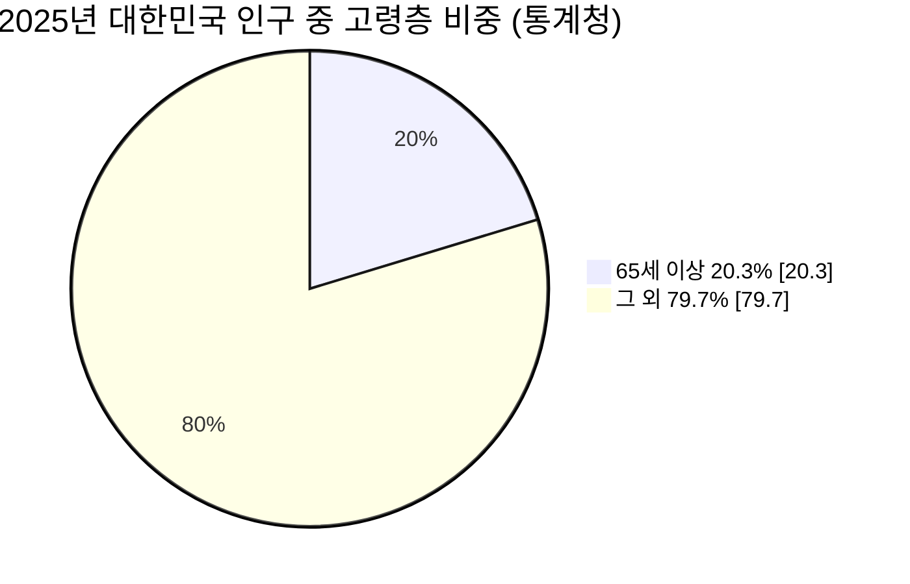

**출처:** [통계청 2025 고령자 통계](https://kostat.go.kr/boardDownload.es?bid=10820&list_no=438832&seq=1), [NIA 2025 디지털정보격차 실태조사](https://nia.or.kr/site/nia_kor/ex/bbs/View.do?bcIdx=29168&cbIdx=81623&parentSeq=29168), [복지로 맞춤형급여안내](https://www.bokjiro.go.kr/ssis-tbu/twatza/wmAplyMng/selectWmGdnc.do).

> **주의:** 이 수치는 사회·시장 배경이며, “고령층 사용자 중 몇 %가 우리 앱을 쓸 것인지”나 “실제 이용자의 불편 비율”을 측정한 것은 아니다.

**발표 멘트:** “2025년 기준 5명 중 약 1명이 고령층입니다. 문제의 규모를 보여주지만, 이 통계만으로 수요를 단정하지는 않습니다. 그래서 서비스 사용성은 별도 사용자 테스트가 필요합니다.”

---

# 슬라이드 03. 기존 서비스 조사: 차별화의 위치를 정직하게 잡기

| 비교 대상 | 공식적으로 확인한 역할 | 우리 프로젝트에서 추가로 검증할 가치 |
|---|---|---|
| **복지로 맞춤형급여안내(복지멤버십)** | 공적자료에 기반해 개인이 받을 **가능성 있는 서비스**를 안내 | 공식 정책 설명과 PDF 근거를 **문장 단위로 검색·요약**하는 RAG 실습 |
| **보건복지상담센터 129** | 보건복지 상담 전화 및 온라인 상담 | 불확실한 경우 상담원으로 연결하는 안내 설계 |
| **일반 LLM** | 자연어 답변 생성 가능 | **우리 데이터셋의 policy_id·출처·지역 검수 상태를 명시적으로 관리**하고 평가 가능 |
| **우리 MVP(계획)** | 공식 API·PDF 검색 후 근거 포함 쉬운 답변 | 출처 ID 일치, 지역 미승인 처리, 표 문맥 보존을 **실제 수치로 검증** |

**중요:** “복지로는 맞춤형 기능이 없다”, “기존 서비스는 틀리다” 또는 “ChatGPT는 공공데이터를 읽을 수 없다”는 식의 **비교 주장은 하지 않는다**. 차별점은 **RAG 파이프라인을 독립적으로 구현하고 정확성을 측정하는 실습 역량**이다.

**출처:** [복지멤버십 제도 안내](https://www.bokjiro.go.kr/ssis-tbu/twatza/wmAplyMng/selectWmGdnc.do), [보건복지상담센터](https://www.129.go.kr/).

**발표 멘트:** “이미 훌륭한 공공서비스가 있습니다. 저희는 그 서비스를 이기겠다고 주장하기보다, 공식 데이터를 안전한 근거 검색으로 연결하는 기술을 직접 구현하고 검증하는 데 집중했습니다.”

---

# 슬라이드 04. 사용자 Pain Points → 기술 요구사항

| 사용자의 예상 어려움 **[가설]** | 고령층 사용자 관점의 쉬운 설명 | 우리가 대응할 기술 |
|---|---|---|
| 정책 이름을 모름 | “생활비 도움을 받고 싶은데 이름을 몰라요” | **Dense Embedding**: 의미로 검색 |
| 지역에 따라 제도가 다름 | “남의 지역 정책이 나오면 곤란해요” | 지역 메타데이터 + **검증된 범위만 필터** |
| 문서가 어려움 | “예외 조건이 너무 많아요” | 정책 항목별 Splitting + Qwen 쉬운 설명 |
| 금액과 연도가 헷갈림 | “올해 얼마인지 정확히 알고 싶어요” | **표·연도 문맥을 보존**한 PDF 청킹 |
| AI가 자신 있게 틀림 | “정말 근거가 있나요?” | Qdrant+Neo4j 출처 추적 + 검증된 인용 |
| 작은 글씨/복잡한 화면 | “한눈에 보기 어려워요” | 큰 글씨, 짧은 문장, 129 안내 UI |

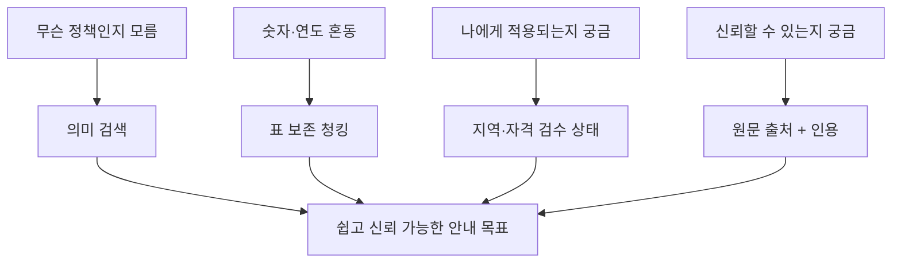

> **증거 수준:** 위 불편은 사용자 시나리오에서 추론한 **설계 가설**이며 사용자 인터뷰 결과로 발표하면 안 된다. 발표 전 3~5명의 사용자/가족/복지 실무자 대상 간단한 인터뷰를 진행하면 근거가 강해진다.

**발표 멘트:** “사용자가 무엇을 불편해할지 먼저 생각한 다음, 각각을 어떤 RAG 기술로 해결할지 대응표를 만들었습니다. 모든 기술에는 역할이 있어야 하기 때문입니다.”

---

# 슬라이드 05. 우리가 배운 RAG, 가장 쉽게 설명하기

### RAG = Retrieval-Augmented Generation


**일상 비유:**

- **일반 LLM만 사용:** 직원이 기억만으로 설명한다.
- **RAG 사용:** 직원이 **공식 안내서를 먼저 찾아보고**, 그 근거를 바탕으로 설명한다.
- **우리의 추가 규칙:** 잘못된 책·오래된 규정·다른 지역의 내용을 찾았다면 **그대로 답하지 않는다**.

**발표 멘트:** “RAG에서 가장 중요한 것은 ‘예쁘게 답하기’보다 먼저 ‘정확한 근거를 찾기’입니다. 그래서 저희는 LLM 연결 전에 데이터 구축과 Splitting에 많은 시간을 썼습니다.”

---

# 슬라이드 06. 왜 단순 웹 검색만 하지 않고 공식 데이터셋을 확보했나?

| 선택 | 단점/한계 | 우리가 채택한 방법 |
|---|---|---|
| 임의 웹 검색만 사용 | 형식이 들쭉날쭉하고 자동 비교·재현이 어려움 | 공식 API 원본과 정식 PDF를 **버전별 보관** |
| PDF만 검색 | 정책 ID·지역·신청 조건을 구조적으로 비교하기 어려움 | **API 정책 구조화 + PDF 근거 병행** |
| API만 검색 | 긴 예외 규정·표·원문 페이지의 맥락이 빠질 수 있음 | 원본 **PDF 5종**과 연결 준비 |
| 문서를 한 파일로 합치기 | 출처, 정책 종류, 지역 구분이 사라짐 | **정책/공식 문서/시설**을 별도 데이터 모델로 관리 |

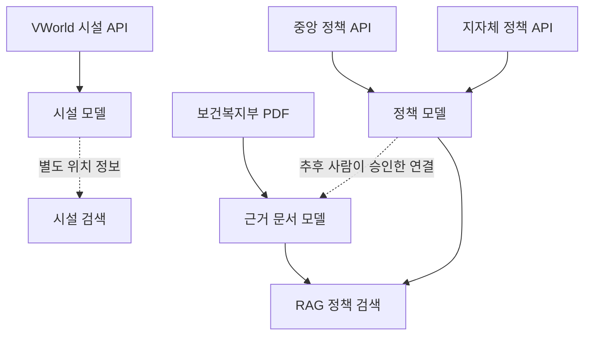

**핵심 설계 원칙:** 서로 성격이 다른 자료를 억지로 하나의 표에 넣지 않는다. 데이터의 **원래 역할을 살려 통합**한다.

**발표 멘트:** “API는 정책의 구조를 주고, PDF는 상세 근거를 주며, 시설 데이터는 위치 정보를 줍니다. 한 문서에 전부 붙이면 빠르게 만들 수 있어 보여도 나중에 정확한 답변을 만들기 어려워집니다.”

---

# 슬라이드 07. 실제 수집한 데이터: 4개 계층

| 데이터 | 소스 | 확보 수 | 상세 상황 |
|---|---|---:|---|
| 중앙부처 복지정책 | 복지로 중앙 API | **461 정책** | **461건 상세 확보** |
| 서울 지자체 정책 | 지자체 API | **397 정책** | 상세 확보 |
| 경기 지자체 정책 | 지자체 API | **692 정책** | 상세 207, **미확보 485** |
| 전북 지자체 정책 | 지자체 API | **396 정책** | 상세 확보 |
| VWorld 노인복지시설 | VWorld API | **164 시설** | 서울 4·경기 43·전북 57·전남 60 |
| 보건복지부 PDF | 공식 원본 | **5종 원본** | **4종 전처리**, 5번째 미반영 |

<details>
<summary><b>발표 수치 해석에 대한 주의</b></summary>

- 중앙+지자체 1,946은 **레코드 수**이며 독립된 고유 사업종 수를 뜻하지 않는다.
- 164는 **현재 조회된 시설 수**로서 지역 전체 시설의 완전한 목록이라고 주장하면 안 된다.
- 5종 PDF 모두 `dev/data/raw/pdf/`에 존재하지만 현재 로컬 Splitting V3 입력에는 전처리된 **4종**만 있다.

</details>

### 지자체 수집 구성

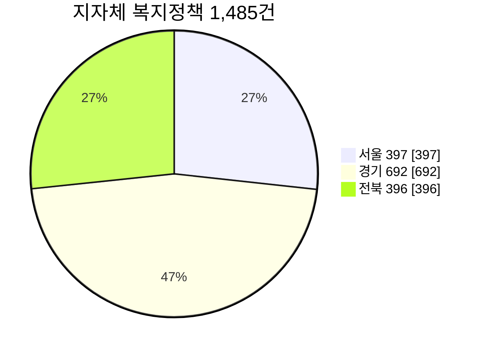

**발표 멘트:** “중앙부처 정책 461건은 상세까지 100% 확보했습니다. 지역 데이터는 1,485건을 확보했지만 경기 485건은 아직 상세가 없습니다. 이 누락 사실을 숨기지 않고 별도 관리합니다.”

---

# 슬라이드 08. 데이터를 어디서 어떻게 가져왔나? — 재현 가능한 수집

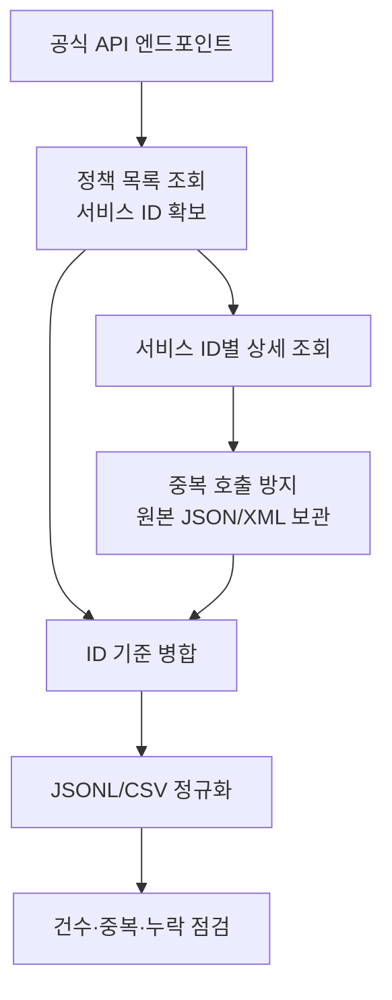

**데이터 수집 구현에서 잘한 점 [확인]:**

1. **목록→상세 2단계 수집**: 목록 제목만으로 자격 조건을 추측하지 않는다.
2. **서비스 ID(`servId`) 중심 결합**: 정책명이 유사해도 다른 사업을 잘못 연결하는 일을 줄인다.
3. **중복 호출 회피**: 중앙 수집 스크립트가 이미 존재하는 XML을 확인하고 건너뛴다.
4. **실패/누락 집계**: 수집 실패는 성공으로 표시하지 않으며 별도 검증 파일에 기록한다.
5. **GitHub 브랜치별 원천 관리**: 팀 작업을 나누고 PR로 통합할 수 있도록 한다.

**이력:** 중앙 상세 확보는 초기 299건에서 **461건**으로 확대. 지자체는 **1,000건 상세 / 485건 미확보** 상태.

**발표 멘트:** “API로 목록을 받아오고 끝내지 않았습니다. 사용자가 실제로 물어볼 대상·지원금·신청 방법은 상세 API에 있기 때문에 `servId`를 이용해 추가 수집했습니다.”

---

# 슬라이드 09. 데이터 수집에서 처리까지: ETL

### ETL = Extract(가져오기) → Transform(정리하기) → Load(저장하기)


| 원본 문제 | 해결 방법 | 실제 코드 산출물 |
|---|---|---|
| JSON과 XML의 필드명 차이 | 공통 정책 스키마 매핑 | `normalized_policies.jsonl` |
| 중앙/지자체에서 동일 ID 형식 사용 | `central:`/`local:` prefix | 고유 `policy_id` |
| 상세정보 없는 정책 | `detail_fetched=false` 보존 | 경기 미수집 검수 목록 485건 |
| 지역 적용이 불분명 | `region_scope=unknown`, `pending` | 지역 검수 파일 1,946건 |
| PDF 표·금액이 길고 복잡 | 원문 섹션/페이지 범위 및 표 문맥 보존 | `normalized_guideline_sections.jsonl` |
| 시설을 정책과 혼동할 수 있음 | 시설 별도 모델과 좌표 관리 | `normalized_facilities.jsonl` |

**발표 멘트:** “서로 다른 서류들을 같은 구조의 정책 카드로 만드는 과정입니다. 중요한 것은 데이터를 보기 좋게 바꾼 것이 아니라, 없는 내용을 만들어 넣지 않았다는 점입니다.”

---

# 슬라이드 10. 왜 JSONL 형식을 선택했나?

**JSONL = 한 줄에 한 개의 JSON 객체가 들어 있는 데이터 파일**.

```text
1번째 줄: {"policy_id": "central:WLF...", "title": "...", ...}
2번째 줄: {"policy_id": "local:WLF...",   "title": "...", ...}
3번째 줄: {"policy_id": "central:WLF...", "title": "...", ...}
```

| 기존 고민 | JSONL 선택 근거 |
|---|---|
| Excel/CSV로 긴 서술 필드를 읽기 어려움 | 여러 줄의 정책 설명·배열을 구조적으로 보존 |
| 일부 데이터만 다시 처리하고 싶음 | 줄 단위 읽기·로그·건수 검사가 간단 |
| API/시설/PDF가 서로 다름 | 각각의 타입별 스키마로 통일해 검증 가능 |
| Qdrant에 여러 개 업로드해야 함 | 레코드를 순차 처리·배치 업서트하기 쉬움 |

**주의:** JSONL 형식만으로 검색 성능이 좋아지는 것은 아니다. **정책마다 메타데이터·본문·ID를 일관되게 보존한다는 점**이 핵심이다.

**발표 멘트:** “엑셀의 한 행을 조금 더 유연한 JSON 형태로 저장한 것이라고 이해하시면 됩니다. 나중에 수천 개로 나누고 검색할 때 매우 편리합니다.”

---

# 슬라이드 11. 왜 PDF를 별도 처리했나?

### PDF는 ‘긴 정책 지침서’, API는 ‘항목별 정책 카드’

| 항목 | API 정책 | 공식 PDF 지침 |
|---|---|---|
| 내용 | 정책명, 대상, 지원내용, 신청방법 | 법령·예외·연도·표·운영 기준 |
| 문서 구조 | `policy_id` 단위 | 문서 → 사업 → 장·절 → 페이지 |
| 검색 실수 유형 | 잘못된 지역/누락된 상세 | 숫자·표의 행열 분리, 부정확한 페이지 |
| 분할 단위 | 지원대상/선정기준/혜택/신청 | 문서 섹션 + 표 문맥 |

**PDF 4종 전처리 실제 섹션 수:**

| 문서 | 섹션 |
|---|---:|
| `2026년 기초연금 사업안내` | 186 |
| `2026 나에게 힘이 되는 복지서비스` 종합본 | 530 |
| `2026 노인보건복지사업안내 1권` | 209 |
| `2026 노인보건복지사업안내 2권` | 264 |
| **합계** | **1,189** |

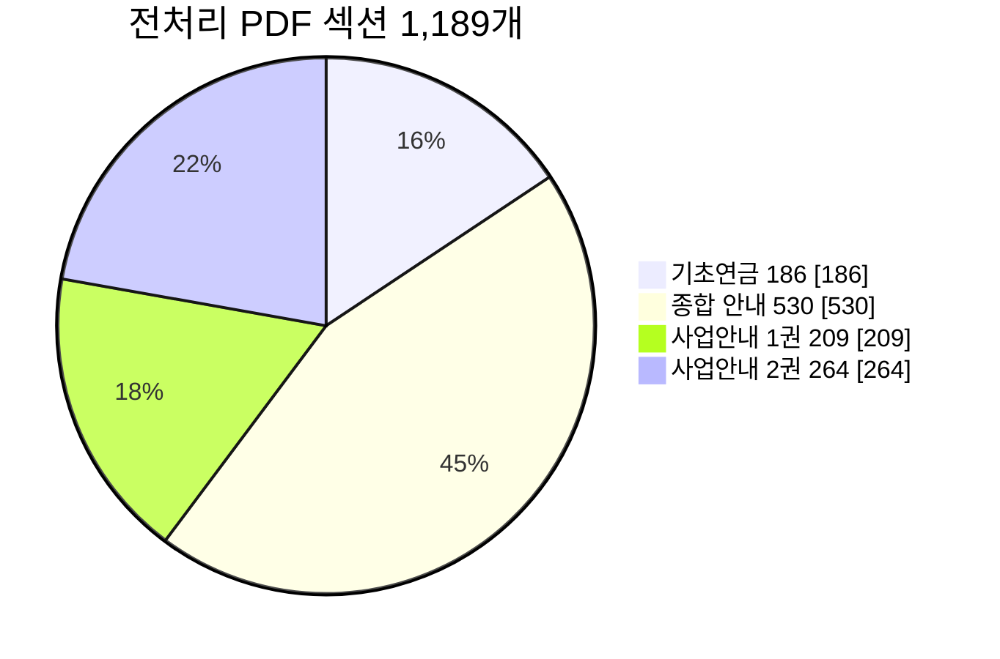

**발표 멘트:** “PDF는 목차와 사업 구성을 살리지 않고 그냥 자르면 출처가 뒤섞입니다. 그래서 먼저 섹션 단위로 구조화한 뒤, 각 섹션을 다시 검색에 적합한 크기로 분할했습니다.”

---

# 슬라이드 12. Splitting이란 무엇인가? (비전공자용)

**Splitting = 긴 문서를 AI가 찾아 읽기 좋게 작은 의미 단위로 나누는 작업**.

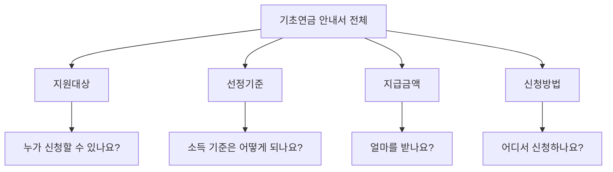

**비유:** 500페이지짜리 책을 통째로 건네기보다, 질문과 관련된 **정확한 쪽지**를 찾아 주는 것.

- **너무 크게 자르면:** 상관없는 내용이 섞여 검색이 흐려질 수 있다.
- **너무 작게 자르면:** “2026년”과 “349,700원”처럼 연결돼야 할 정보가 분리된다.
- **그래서:** 길이와 문서의 **의미 경계**를 둘 다 고려해야 한다.

**발표 멘트:** “Splitting은 잘게 자르는 행위가 목표가 아니라, AI가 필요한 근거를 다시 조립할 수 있게 하는 것이 목표입니다.”

---

# 슬라이드 13. 왜 ‘정책 항목별’로 Splitting했는가? ★ 핵심 설계 근거

| 질문 유형 | 필요한 정책 데이터 | 분할 논리 |
|---|---|---|
| “제가 대상인가요?” | 지원대상 / 선정기준 | **대상과 조건**을 함께 또는 연관되게 검색 |
| “어떤 도움을 받나요?” | 혜택 / 지원금액 | **지원내용** 중심 검색 |
| “어떻게 신청하나요?” | 신청방법 / 서류 / 절차 | **신청 과정** 중심 검색 |
| “언제까지 되나요?” | 시행기간 / 수정일 | **시점 메타데이터** 함께 제시 |

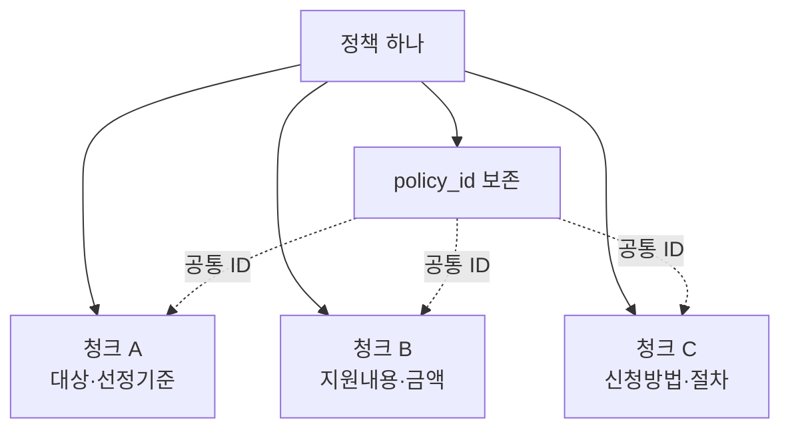

**설득 포인트:**

1. **사용자 질문과 데이터 구조가 일치한다.** 사용자는 정책 전부가 아니라 특정 항목을 묻는다.
2. **원본 정책 ID를 계속 유지한다.** 검색된 청크가 어느 정책에서 왔는지 추적할 수 있다.
3. **중앙/지자체를 구분한다.** 같은 `WLF...` 형식이더라도 `central:`과 `local:`을 분리한다.
4. **없는 항목은 공란으로 둔다.** 상세 485건 미확보를 LLM이 마음대로 보충하지 못하게 한다.

**발표 멘트:** “문서를 똑같은 길이로만 자르지 않았습니다. 질문이 ‘누가’, ‘얼마’, ‘어떻게’로 나뉘는 만큼 정책도 그 의미에 따라 나눈 것이 핵심입니다.”

---

# 슬라이드 14. 왜 PDF는 700자 + 90자 겹침으로 시작했나?

| 초기 설정 | 사용 이유 | 한계 |
|---|---|---|
| 정책 본문 최대 **650자** | 한 정책의 특정 항목을 부담 없는 검색 단위로 유지 | 더 긴 예외 조건이 잘릴 수 있음 |
| PDF 본문 최대 **700자** | 관련 내용만 찾아 오기 쉬운 단위 | 표의 열 제목·숫자 분리 가능 |
| 앞뒤 **90자 overlap** | 단락 경계에서 끊긴 문장 문맥 보완 | overlap만으로 표 행·열 관계 복원 불가 |
| **문단 → 줄 → 문장** 경계 우선 | 기계적으로 중간 자르기를 피함 | 원본 추출 품질에 영향 |

```text
원문:  [--------- 청크 A ---------]
                           [--------- 청크 B ---------]
                           ↑ 일부 문맥을 90자 다시 포함
```

**중요한 근거의 수준:** 이 숫자는 **초기 가설/개발 기준**이지 공개 벤치마크에서 정답으로 입증된 설정이 아니다.

**우리가 앞으로 입증할 것:** 450자/650자/900자, overlap 0/90/150 등을 동일 질문으로 비교하여 **검색 회수율과 문맥 유지가 실제로 좋아지는지** 측정한다.

**발표 멘트:** “650자, 700자, 90자를 설정한 이유는 검색 단위를 작게 유지하면서 문장 연결이 끊기지 않게 하려는 것입니다. 다만 최적값이라 주장하지 않고 다음 단계에서 실험으로 검증할 계획입니다.”

---

# 슬라이드 15. V3 핵심 개선: 표의 숫자만 검색되지 않게 한다 ★ 가장 중요

### 문제가 된 예: 연도별 금액 비교표

```text
잘못된 분할

청크 A: | 지원 항목 | 2025년(현행) | 2026년(개정안) |
                           [문장 분할 경계]
청크 B: | 기초연금 최대액 | 342,510원 | 349,700원 |

문제: AI가 청크 B만 보면 어느 금액이 어느 연도인지 모를 수 있음!
```

### 해결: 표의 ‘제목 + 행 + 열 + 연도’를 하나의 검색 카드로

```text
개선된 V3 청크

문서: 기초연금 사업안내
항목: 기초연금 최대액
2025년(현행): 342,510원
2026년(개정안): 349,700원
근거: 원본 section_id 및 페이지 범위
검수상태: 원본 PDF 확인 대기
```


**실제 V3 성과 [실증 완료]:** PDF **표 검색 카드 1,042개**, 원본 표 행 참조 1,024개. 더 긴 셀은 제목을 반복하여 나누되 **원본 표 대조 전 승인하지 않는다**.

> **주의:** 위 금액은 *표 문맥 보존의 기술 시연 예시*다. 공식 정책 안내에 사용하기 전에는 실제 해당연도 PDF 원문을 별도로 검수해야 한다. 특히 “개정안”과 “실제 시행”은 다를 수 있다.

**발표 멘트:** “이 부분이 저희 Splitting 설계의 가장 중요한 근거입니다. 금액을 찾는 것보다 ‘그 금액이 어느 연도와 어느 항목에 속하는지’를 보존해야 합니다.”

---

# 슬라이드 16. Splitting V2 → V3: 실제 개선 전후 비교

| 측정 지표 | V2 | V3 | 해석 |
|---|---:|---:|---|
| 정책 청크 | 6,448 | 6,448 | 정책 분할 방식 유지 |
| PDF 청크 | 2,864 | **3,908** | 표 문맥 복원으로 재구성 증가 |
| 시설 청크 | 164 | 164 | 시설 분리 유지 |
| **전체** | **9,476** | **10,520** | **1,044개 증가** |
| **임베딩 후보** | 9,414 | **10,337** | 목차 등 검색 가치 낮은 청크 제외 |
| 표 검색 카드 | 별도 식별 없음 | **1,042** | 행·열·연도 보존 |
| ID 중복/고아 관계 | 구조 검증 통과 | **구조 검증 통과** | 출처 연결 기반 유지 |

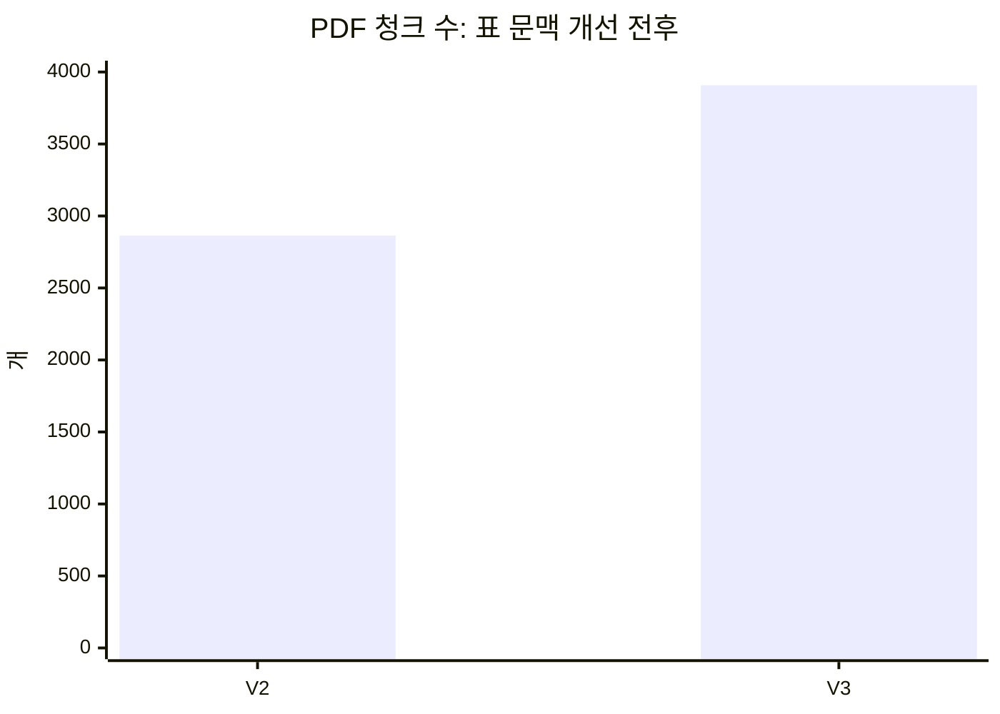

**발표에서 과장하면 안 되는 사실:** 청크가 1,044개 늘었다고 **검색 성능이 개선됐다는 증거가 되는 것은 아니다.** 지금 검증된 것은 **표 문맥 보존과 구조적 산출물 생성**. 검색 정확도는 임베딩 후 80문항 비교실험으로 평가한다.

**발표 멘트:** “개수가 늘었다고 무조건 좋은 건 아닙니다. 이번 개선의 목적은 숫자 증가가 아니라, PDF 표를 읽을 때 연도와 금액이 떨어지지 않게 만든 것입니다.”

---

# 슬라이드 17. 현재까지 확보한 중간 산출물: 무엇이 진짜 완료인가?

<details>
<summary><b>실제 Splitting 결과 파일 열기</b></summary>

| 파일 | 역할 |
|---|---|
| `normalized_policies.jsonl` | 중앙+지자체 통합 1,946정책 |
| `normalized_facilities.jsonl` | 164 시설 |
| `normalized_guideline_sections.jsonl` | 1,189 PDF 섹션 |
| `policy_chunks.jsonl` | 정책 청크 6,448개 |
| `guideline_chunks.jsonl` | PDF 청크 3,908개 |
| `facility_chunks.jsonl` | 시설 청크 164개 |
| `embedding_ready.jsonl` | 임베딩 **입력 후보 10,337개** |
| `neo4j_nodes.jsonl` | 그래프 노드 **내보내기** 13,823개 |
| `neo4j_relationships.jsonl` | 그래프 관계 **내보내기** 11,709개 |
| `split_quality_report.json` | 자동 구조 검증 결과 |
| `index_manifest.json` | 버전·입력 해시·청킹 설정 |

</details>

### 완료 수준을 정확히 표시하기


**V3 품질 보고서:** `structural_validation_passed_semantic_review_pending` — **구조 검증 통과·내용/공식 승인 대기**.

**발표 멘트:** “현재 완료한 것은 실제로 검색에 넣을 준비가 된 청크 데이터를 만드는 것까지입니다. 다음에는 이 청크를 숫자 벡터로 바꾸고, 검색 DB에서 실제 질의로 찾아보겠습니다.”

---

# 슬라이드 18. QA를 어떻게 했나? ‘잘 돌아간다’의 증거

| 점검 | 실제 결과 | 의미 |
|---|---|---|
| 원본 파일 SHA256 일치 | **4개 입력 파일 일치** | 검증한 데이터가 같은 원본인지 추적 |
| 정규화 정책 ID | 1,946개 | 중앙/지자체 통합 기준 |
| 청크 ID 중복 | **0** | DB 저장 시 ID 충돌 방지 |
| Neo4j 관계 고아참조 | **0** | 연결 대상을 잃어버린 관계 없음 |
| Qdrant↔Neo4j ID 연계 | 구조 검사 통과 | 추후 같은 청크를 양쪽 DB에서 찾을 수 있음 |
| Python·Jupyter 실행 | V3 로컬 Run All 통과 | 코드/Notebook 재현성 확인 |
| 공식 자격·금액 확인 | **대기** | 자동 검증으로 보장되지 않음 |
| 모델 토큰 제한 확인 | **미검증** | 모델 선정 후 필요 |

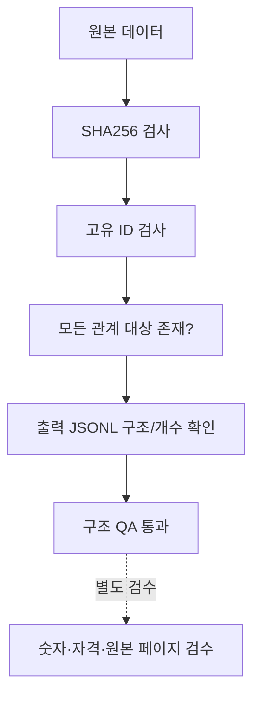

**발표 멘트:** “데이터가 많다고 끝나는 게 아닙니다. 같은 원본으로 재실행해 같은 결과가 나오는지, 중복 ID가 없는지, 그래프 연결이 끊어지지 않는지를 실제로 검사했습니다.”

---

# 슬라이드 19. 데이터 품질 리스크를 숨기지 않았다

| 현재 남은 검수 대상 | 건수 | 실제 위험 |
|---|---:|---|
| 경기 정책 상세 미확보 | **485** | 지원 대상·조건을 확인 못 함 |
| 정책 지역 검수 대기 | **1,946** | 잘못된 지역 정책 추천 위험 |
| 금액·표 관련 PDF 섹션 검토 | **506** | 연도/금액/단위 혼동 위험 |
| PDF 페이지 후보 인용 검토 | **2,314 청크** | 정확하지 않은 페이지를 임의로 표시할 위험 |
| PDF 리뷰 큐 | **777 섹션** | 복잡한 표·긴 섹션·이미지 등 |
| 정책 ↔ PDF 연결 후보 | **564** | 문구 일치 ≠ 공식 동일사업 |
| 5번째 노령층 분권 PDF | **미반영** | 5종 중 4종만 검색 후보 |

**이 숫자들은 반드시 “검토해야 할 후보”이며, 확인된 오류 발생 건수가 아니다.**

**중요한 해결 전략:**

- 미확보 정보는 `false`, `null`, `pending`으로 보존한다.
- 지역이 확인되지 않은 정책은 전국 적용으로 **추정하지 않는다**.
- 이름만 유사한 정책과 PDF는 **자동으로 같은 사업이라고 연결하지 않는다**.
- 최종 수급 자격 판정은 공식 기관의 조사/결정 과정에 남긴다.

**발표 멘트:** “부정확한 정보를 차단하는 것도 RAG의 구현 실력이라고 생각합니다. 특히 고령층을 대상으로 하는 만큼 모르면 모른다고 알려주는 구조를 선택했습니다.”

---

# 슬라이드 20. GitHub 팀 개발 현황

### 11개 브랜치 조사 요약

| 팀 작업 흐름 | 대표 브랜치 | PR 상태 |
|---|---|---|
| 중앙 정책 수집·정규화 | `feature/pre-splitting-ready` | **PR #18 OPEN → Data-Extraction** |
| 지자체·시설 데이터 | `feature/10-api-data-processing` | **PR #16 OPEN → dev** |
| PDF 구조화 | `preprocess_pdf_01` | **PR #17 OPEN → dev** |
| 고령층 화면 | `feature/12-basic-ui` | Mock/실제 RAG 연결 전 |
| 공통 통합 기준 | `dev` | 기능 브랜치 반영·재현 테스트 필요 |
| V3 Splitting | 로컬 별도 패키지 | **GitHub 통합 여부 미확인** |

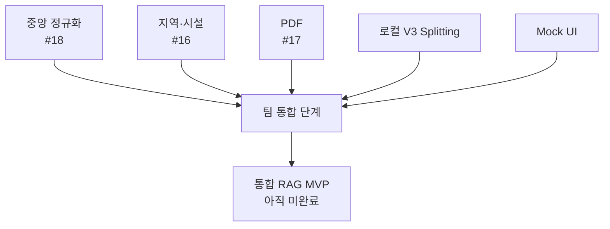

**GitHub 브랜치별 제출물 = 팀 완성본이 아니다.** **로컬 성공·PR 생성·dev 병합·통합 테스트**를 따로 표시해야 프로젝트 현황을 정직하게 전달할 수 있다.

**발표 멘트:** “팀원이 각 분야를 병렬로 개발한 덕분에 수집과 PDF 처리, UI 시안을 동시에 진행했습니다. 현재는 이 결과물을 한 브랜치에서 동작하도록 통합하는 것이 다음 관문입니다.”

---

# 슬라이드 21. 다음 기술 단계 ① Embedding → 검색

### 왜 Embedding이 필요한가?

**사람의 질문과 정책 문구가 다를 수 있기 때문**이다. "노후 생활비 도와주는 제도"와 "기초연금"처럼 단어가 달라도 의미가 유사한 근거를 찾아야 한다.

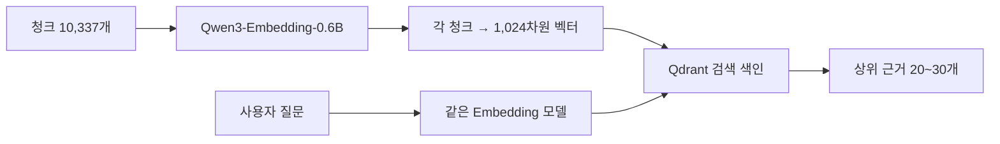

| 기술 선택 | 1차 추천 | 이유 |
|---|---|---|
| 임베딩 | **`Qwen3-Embedding-0.6B`** | 다국어 지원, 비교적 가볍고 1,024차원 벡터 사용 가능 |
| 벡터DB | **Qdrant** | 의미검색 + 필터 + Hybrid 확장 |
| 키워드 검색 | **BM25** | 정책명·연도·금액처럼 정확 단어에 강점 |
| 검색 재정렬 | **`Qwen3-Reranker-0.6B`** (평가 후) | 1차 후보 중 실제 질문 적합성 비교 |

**정량적 다음 과업:** `Dense-only` vs `BM25-only` vs `Hybrid(RRF)` vs `Hybrid+Rerank` 결과 비교.

**발표 멘트:** “Splitting된 문장에 숫자로 된 의미 주소를 부여하는 과정이 Embedding입니다. 처음에는 가벼운 모델로 전 과정을 완성하고, 실제 질문 데이터에서 좋은 모델인지 확인하겠습니다.”

---

# 슬라이드 22. 다음 기술 단계 ② Qdrant + Neo4j + Qwen

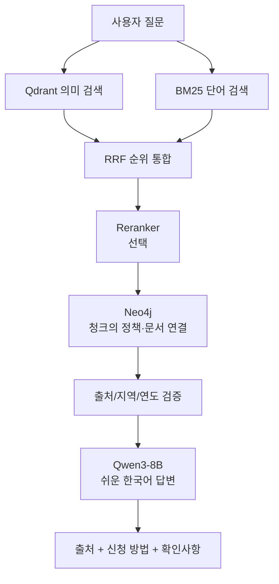

| 구성요소 | 담당할 일 | 현재 상태 |
|---|---|---|
| Qdrant | 질문과 유사한 문서 검색 | 미구현 |
| Neo4j | 검색한 청크가 어느 정책·문서의 것인지 추적 | 입력 JSONL만 생성 |
| Qwen3-8B | 찾은 근거를 쉬운 문장으로 설명 | 미연결 |
| SYSTEM 메시지 | 근거 없는 자격·금액 단정 금지 | 규칙 초안 작성 가능 |
| Streamlit UI | 큰 글씨, 질문, 출처, 전화상담 | Mock 시안 존재 |

**모델 선택 원칙:** `Qwen3-8B`로 먼저 텍스트 RAG를 완성, `Qwen3.5-9B`는 GPU·한국어 정확성·응답속도를 비교한 뒤 채택 여부 결정.

**발표 멘트:** “Qdrant는 문장을 찾는 역할, Neo4j는 출처 관계를 확인하는 역할, Qwen은 쉽게 설명하는 역할입니다. 각 도구가 무엇을 해결하는지 분명히 나눴습니다.”

---

# 슬라이드 23. SYSTEM 메시지로 어떤 답변 원칙을 정할 것인가?

### 예시 사용자 질문

> “서울에 사는 72세인데 기초연금 받을 수 있나요?”

**나쁜 답변(금지):** "네, 무조건 받을 수 있습니다. 매월 OO만 원을 받습니다."

**좋은 답변(설계 목표):** "연령은 확인됐지만, 신청 가능 여부는 소득·재산과 다른 조건을 확인해야 합니다. 확인할 항목과 공식 신청방법을 알려드리겠습니다. 해당 기준의 출처는 …입니다."

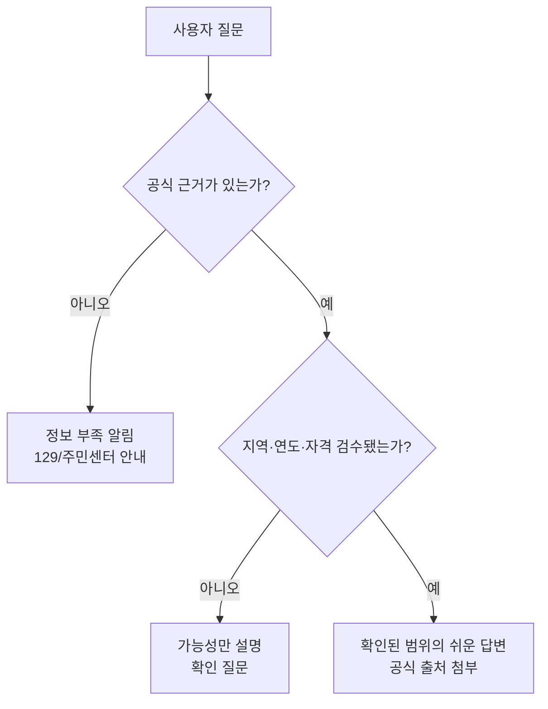

**SYSTEM 메시지의 네 원칙:** ① **찾은 근거만 사용**, ② **모르면 추측 금지**, ③ **짧고 쉬운 한국어**, ④ **정책 ID·PDF 출처가 실제로 확인된 경우만 인용**.

**발표 멘트:** “모델이 유창하게 말하는 것보다, 답할 수 없는 상황에서 정확히 멈추는 것이 중요합니다. SYSTEM 메시지와 코드상의 검증을 함께 사용할 계획입니다.”

---

# 슬라이드 24. 우리 프로젝트의 성능을 어떻게 증명할까?

### ‘잘 구현했다’의 기준은 화면이 아니라 실험 결과

| 평가 주제 | 실험 | 보고할 숫자 |
|---|---|---|
| 정확한 근거 찾기 | 80개 질문에 대해 정답 정책/문서 지정 | `Recall@5`, `MRR@10` |
| 잘 만든 Splitting인가? | 단순 문자 단위 vs V3 표 문맥 보존 | 금액/연도 질문 정답 근거 회수율 |
| Hybrid 이점이 있는가? | Dense vs Dense+BM25 | `nDCG@10`, 응답속도 |
| Reranker가 필요한가? | 재정렬 OFF/ON | 순위 개선 vs 지연 증가 |
| 안전한 답변인가? | 소득 미확인·지역 오류·연도충돌 반례 | 근거 없는 자격/금액 단정 건수 |
| 고령층에게 쉬운가? | 큰 글씨·짧은 설명·출처 UI 시연 | 이해도/사용성 피드백 |

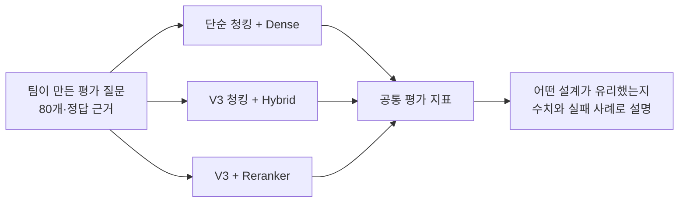

> **평가 점수는 아직 없다.** 실제 질문의 레이블링·검색 실행이 끝나기 전에는 성능 개선률·정확도 수치를 발표 자료에 넣으면 안 된다.

**발표 멘트:** “최고의 모델이 무엇인지 주장하는 대신, 어떤 조건에서 어떤 검색 방법이 더 정확한지 같은 질문으로 비교하겠습니다. 이 비교가 가장 중요한 RAG 학습 성과라고 생각합니다.”

---

# 슬라이드 25. 현재까지의 성과와 앞으로의 우선순위

## 지금까지 실제로 증명한 것

- ✅ 공식 데이터 **중앙 461 + 지자체 1,485** 정책 원천 확보
- ✅ 시설 데이터 **164** 건 확보
- ✅ PDF 원본 **5종** 확보, **4종/1,189섹션 전처리**
- ✅ 통합 로컬 Splitting V3 **10,520청크**, 임베딩 후보 **10,337개**
- ✅ PDF 표 검색 카드 **1,042개**로 연도·행·열 문맥 보존 개선
- ✅ 청크 UUID·Neo4j 그래프 참조의 **구조 무결성 검증**

## 다음 과제

1. **팀 GitHub 통합:** #16/#17/#18 + 로컬 V3 결합, 데이터 경로와 버전 통일.
2. **데이터 정확성:** 경기 485 상세 미확보 처리, PDF 5번째 섹션 검수, 지역·금액·페이지 검수.
3. **Embedding:** Qwen3-Embedding-0.6B로 토큰 전수검사 → 벡터 생성 → Qdrant 색인.
4. **검색:** Dense+BM25+RRF, 필요하면 Reranker, Neo4j 출처 연결.
5. **답변:** Qwen3-8B + SYSTEM 메시지 + 근거 검증 + UI `USE_MOCK=false`.
6. **평가:** 80문항과 설계 비교실험으로 왜 이 구조가 유리한지 증명.

**발표 마무리 멘트:**

> “저희 프로젝트는 복지정책 챗봇이라는 화면보다, 공식 데이터를 어떻게 신뢰 가능한 검색 근거로 바꾸는지에 집중했습니다. 특히 PDF 표의 연도·금액 문맥을 보존하도록 Splitting을 개선했고, 데이터가 부족하거나 검증되지 않은 부분은 숨기지 않았습니다. 다음 단계에서는 실제 임베딩과 검색·LLM 답변까지 연결하고, 성능을 수치로 입증하겠습니다.”

---

# 부록 A. 발표에서 나올 만한 어려운 질문 10개와 모범 답변

| 질문 | 짧게 답변하기 |
|---|---|
| 왜 굳이 RAG인가요? | “일반 LLM이 기억으로 답하는 대신 공식 정책 문서에서 관련 근거를 검색한 후 답하도록 만들기 위해서입니다.” |
| 왜 API와 PDF를 같이 쓰나요? | “API는 구조화된 정책 정보, PDF는 상세 기준과 예외를 주기 때문입니다.” |
| 왜 650/700자예요? | “검색 단위 크기와 문맥 유지의 균형을 위한 **초기값**입니다. 다음 단계에서 실험으로 검증합니다.” |
| 왜 overlap이 필요해요? | “문장·문단이 경계에서 잘릴 때 맥락을 보완하기 위해서입니다. 하지만 표는 별도 처리했습니다.” |
| 청크가 늘면 좋은 건가요? | “아닙니다. V3의 핵심은 청크 수 증가가 아니라 **연도·금액 관계 보존**입니다.” |
| 왜 Qdrant를 쓰나요? | “자연어 질문을 의미 벡터로 검색하고 정책 메타데이터를 함께 관리할 수 있기 때문입니다.” |
| 왜 Neo4j까지 쓰나요? | “청크가 어떤 정책과 공식 문서에 속하는지 그래프 형태로 추적하기 위해서입니다.” |
| 왜 바로 Qwen3.5를 안 쓰나요? | “모델의 이름보다 실제 검색 근거 충실도·자원·지연을 비교해 선택하기 위해서입니다.” |
| 개인 맞춤 추천을 지금 하나요? | “아직 아닙니다. 지역·자격 검증 없이 실제 수급 가능성을 확정하는 것은 위험합니다.” |
| 정확도 몇 %인가요? | “아직 임베딩·검색 테스트 전이므로 수치가 없습니다. 평가셋과 비교실험을 진행할 계획입니다.” |

---

# 부록 B. 팀원별 발표 분담 및 시연 추천

| 역할 | 발표 슬라이드 | 시연 화면 |
|---|---|---|
| 기획/시장 | 1~5 | 서비스 문제·RAG 기본 개념 |
| 데이터 수집 | 6~10 | 중앙/지역 API JSONL + 품질 보고서 |
| PDF·Splitting | 11~19 | **V2/V3 표 청크 실제 비교** + `split_quality_report.json` |
| 통합/검색 | 20~22 | 브랜치별 PR 상태, 앞으로의 검색 아키텍처 |
| LLM/평가 | 23~25 | SYSTEM 메시지, 실패 시나리오, 향후 평가 계획 |

**가장 중요한 실제 데모:**

1. `policies.jsonl` 461 정책에 상세가 모두 있는지 보여주기.
2. 지역 전체 JSONL 1,485건 중 `detail_fetched=false`가 485건임을 보여주기.
3. **V2 기초연금 표 청크와 V3 표 검색 카드를 나란히 열어 보여주기** — 문맥 왜곡 가능성과 개선 내용을 직관적으로 증명.
4. `embedding_ready.jsonl`의 출처/`policy_id`와 `neo4j_nodes.jsonl`의 동일 UUID를 비교.
5. UI는 **Mock 시안**임을 명시하고 `USE_MOCK=false`는 아직 실제 RAG 미구현임을 설명.

---

# 부록 C. 발표 자료 제작 시 확인할 공식 출처

## 시장·기존 서비스

- [통계청, 2025 고령자 통계](https://kostat.go.kr/boardDownload.es?bid=10820&list_no=438832&seq=1): 2025년 고령인구 1,051만 4천 명, 20.3%.
- [NIA, 2025 디지털정보격차 실태조사](https://nia.or.kr/site/nia_kor/ex/bbs/View.do?bcIdx=29168&cbIdx=81623&parentSeq=29168): 고령층 디지털 정보화 조사.
- [복지로, 맞춤형급여안내](https://www.bokjiro.go.kr/ssis-tbu/twatza/wmAplyMng/selectWmGdnc.do): 기존 제도 기능과 정확한 비교.
- [보건복지상담센터 129](https://www.129.go.kr/): 실제 상담 연결 정보.

## 직접 검증 가능한 우리 팀 산출물

- [중앙 정책 품질보고서](https://github.com/SKNETWORKS-FAMILY-AICAMP/SKN36-3rd-3Team/blob/feature/pre-splitting-ready/data/validation/quality_report.json)
- [지자체 API/시설 원본](https://github.com/SKNETWORKS-FAMILY-AICAMP/SKN36-3rd-3Team/tree/feature/10-api-data-processing/data/raw/api)
- [PDF 전처리 결과](https://github.com/SKNETWORKS-FAMILY-AICAMP/SKN36-3rd-3Team/tree/preprocess_pdf_01/data/preprocessed)
- [현재 UI 코드](https://github.com/SKNETWORKS-FAMILY-AICAMP/SKN36-3rd-3Team/tree/feature/12-basic-ui/src/ui)
- [현재 평가 계획](https://github.com/SKNETWORKS-FAMILY-AICAMP/SKN36-3rd-3Team/blob/dev/docs/evaluation.md)
- 로컬 V3 `split_quality_report.json`, `index_manifest.json`, `SKN36_auto_splitting.py`, 실행 Notebook. **GitHub 통합 완료로 오인하지 말 것.**

## 후속 기술 자료

- [Qwen3 Embedding](https://huggingface.co/Qwen/Qwen3-Embedding-0.6B)
- [Qwen3-8B](https://huggingface.co/Qwen/Qwen3-8B)
- [Qwen3.5-9B](https://huggingface.co/Qwen/Qwen3.5-9B)
- [Qdrant Hybrid Search](https://qdrant.tech/documentation/search-tuning/hybrid-search/)

---

# 최종 발표 점검표

- [ ] 모든 그림에 **현재 완료와 미래 설계를 구분**했는가?
- [ ] 정책 1,946개를 **유일한 사업 1,946개**라고 잘못 설명하지 않는가?
- [ ] PDF **원본 5종 / 실제 처리 4종**을 구분하는가?
- [ ] **왜 정책 항목별·PDF 표 구조별로 분할하는지** 쉽게 설명하는가?
- [ ] **650/700/90의 가설성과 추후 실험 계획**을 말하는가?
- [ ] **V2→V3 표 문맥 실제 사례**를 보여주는가?
- [ ] 10,337개 임베딩 후보를 **완성된 벡터 수**라고 하지 않는가?
- [ ] UI를 실제 RAG 완성본처럼 시연하지 않는가?
- [ ] 시장 수치에는 공식 자료 출처가 있고, pain point는 가설로 표시했는가?
- [ ] 보완 위험·미검증 데이터·향후 평가 지표를 솔직히 표시했는가?

> **마지막 메시지:** “우리의 성과는 단순히 많은 데이터를 모은 게 아니라, **왜 그런 구조로 저장하고 분할했는지 기술적 이유를 설명하고 검증할 수 있도록 만든 것**입니다.”
